# Лаба 1 — свой Docker

Работаю на маке, а namespaces, cgroups и seccomp есть только в ядре Linux. Поэтому всё гоняю в виртуалке через Lima (Ubuntu 26.04, ядро 7.0, cgroup v2). Папка с репой примонтирована в VM, так что код правлю в GoLand, а запускаю в VM.

## Часть 0 — сервис

Сервис на **Go**, без зависимостей: [`api/main.go`](api/main.go).

- `/health` — отдаёт `ok`
- `/eat?mb=N` — съедает N МБ и держит их (пишу в каждую страницу памяти, иначе ядро реально ничего не выделит)
- `/burn` — крутит бесконечный цикл, грузит одно ядро на 100%

Собираю на маке сразу под линукс, статический бинарник:

```bash
GOOS=linux GOARCH=arm64 CGO_ENABLED=0 go build -o api .
```

## Часть 1 — запускаю как обычный процесс

Просто `./api &` в VM. В браузере на маке открывается, Lima сама пробрасывает порт:

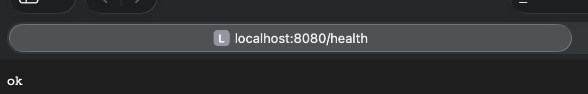

На хосте это обычный процесс от моего юзера (uid 502):

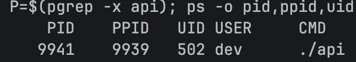

Что у него сейчас (это точка отсчёта, дальше буду с ней сравнивать):

```
$ ls -l /proc/$P/ns
cgroup -> 'cgroup:[4026531835]'
ipc -> 'ipc:[4026531839]'
mnt -> 'mnt:[4026531832]'
net -> 'net:[4026531833]'
pid -> 'pid:[4026531836]'
time -> 'time:[4026531834]'
user -> 'user:[4026531837]'
uts -> 'uts:[4026531838]'

$ cat /proc/$P/cgroup
0::/user.slice/user-502.slice/session-6.scope

$ grep Cap /proc/$P/status
CapInh: 0000000000000000
CapPrm: 0000000000000000
CapEff: 0000000000000000
CapBnd: 000001ffffffffff
CapAmb: 0000000000000000
```

Что из этого видно:

- **namespaces** — числа это номера inode namespace'ов. Если у двух процессов номер одинаковый — они в одном namespace. Номера 40265318xx это начальные namespaces, которые ядро создаёт при загрузке, в них сидят все обычные процессы, включая systemd. То есть никакой изоляции.
- **cgroup** — процесс сидит в обычной сессии моего юзера, лимитов там нет. Если дёрнуть `/eat` на 10 ГБ, он будет жрать память всей VM, пока не придёт глобальный OOM killer, и убьёт он не обязательно `api`.
- **capabilities** — Eff и Prm нулевые, потому что процесс запущен от обычного юзера, а не от root. Bnd полный — это потолок, выше которого процесс никогда не получит прав. В контейнере процесс обычно root, поэтому там как раз важно урезать Bnd (это часть 4).

## Часть 2 — namespaces

### Сначала один namespace для разминки — UTS

`sudo unshare --uts bash`, внутри `hostname test`. Внутри имя поменялось, а во втором терминале осталось `lima-lab`. Из всех ссылок в `/proc/$$/ns` поменялась только `uts`:

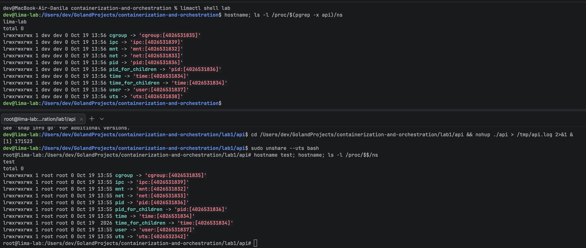

Hostname хранится внутри UTS namespace. `unshare --uts` сделал новый namespace с копией имени, я поменял имя в копии — хост этого не видит. Остальные ссылки остались хостовыми, потому что отделял только UTS. Отсюда главное: **namespaces независимы по типам**, каждый отделяется своим флагом, а контейнер — это когда отделили все сразу.

Без `sudo` не работает: для создания namespace нужна `CAP_SYS_ADMIN`.

### Ubuntu не даёт делать user namespace

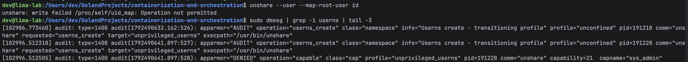

User namespace — единственный, который можно создать без root, и уже изнутри него делать остальные (так работает rootless Docker/Podman). Но тут:

- `unshare --user id` → `nobody`: маппинга uid нет, ядро не знает, кто я внутри, и показывает «неотображённый» uid 65534;
- `unshare --user --map-root-user id` → `Operation not permitted`. В `dmesg` видно, что это AppArmor: переводит процесс в профиль `unprivileged_userns` и запрещает `sys_admin`.

Зачем Ubuntu так делает: внутри user namespace обычный юзер получает `CAP_SYS_ADMIN` и может дёргать куски ядра, которые раньше были только для root (монтирование, сетевые штуки, nf_tables). Штатно на хост это не действует, но если в этом коде ядра баг — через него можно получить настоящий root. То есть закрывают поверхность атаки на ядро.

Для лабы выключил: `sudo sysctl -w kernel.apparmor_restrict_unprivileged_userns=0`.

### Root внутри, а снаружи я обычный юзер

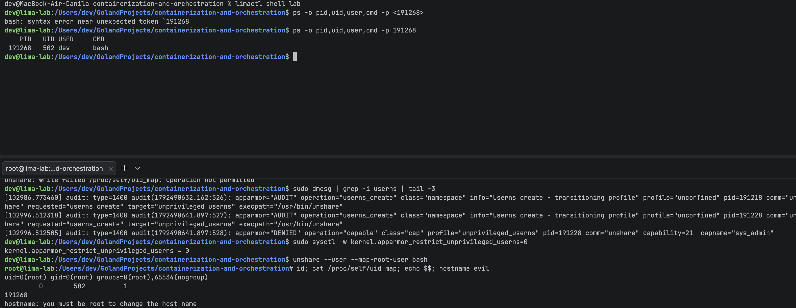

- внутри `id` говорит `uid=0(root)`, а снаружи `ps` показывает тот же процесс с uid 502;
- `uid_map` = `0 502 1`: uid 0 внутри = uid 502 снаружи, длина диапазона 1 (отображён один uid). В rootless Docker там обычно `0 100000 65536`, тогда uid 1000 внутри = 101000 снаружи;
- `hostname evil` → «you must be root». Я root, но только в своём user namespace, а UTS namespace остался хостовым и принадлежит хостовому user namespace. Если добавить `--uts`, новый UTS будет принадлежать моему user namespace и hostname поменяется.

### Остальные namespaces по одному

Всё без sudo: `unshare -Ur` (это `--user --map-root-user`) + нужный флаг.

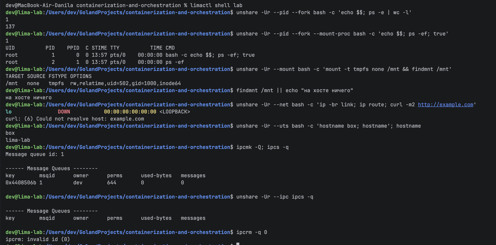

| Namespace | Что делал | Что он прячет |
|---|---|---|
| user | `unshare -Ur bash` → `id`, `uid_map`, `ps` снаружи | uid/gid и capabilities. Внутри root, снаружи обычный юзер 502 |
| pid | `unshare -Ur --pid --fork` с `--mount-proc` и без | номера процессов. Внутри свой PID 1, чужих процессов не видно |
| mount | `mount -t tmpfs none /mnt` внутри, `findmnt /mnt` снаружи | таблицу монтирований. Что смонтировал внутри — снаружи не видно |
| net | `ip -br link`, `ip route`, `curl` внутри | весь сетевой стек: интерфейсы, маршруты, порты. Внутри только выключенный `lo` |
| uts | `hostname box` внутри, `hostname` снаружи | hostname |
| ipc | `ipcmk -Q` на хосте, `ipcs -q` внутри | очереди сообщений и общую память (SysV IPC). Хостовую очередь внутри не видно |

Что словил по ходу:

- **pid без `--mount-proc`**: `$$` = 1, а `ps` видит 137 процессов хоста. Потому что `ps` просто читает папку `/proc`, а `/proc` — это файловая система, привязанная к PID namespace того, кто её смонтировал. Старый `/proc` хостовый, поэтому нужен свежий — это и делает `--mount-proc`.
- **mount не прячет файлы**: mount namespace копирует только таблицу монтирований, а файлы те же самые, хостовые. Чтобы у процесса была своя ФС, нужен отдельный корень и `pivot_root`/`chroot` — это то, что даёт образ (часть 6).
- **net пустой**: чтобы дать сеть, нужна veth-пара (один конец внутри, другой на хосте), IP и маршрут, а на хосте `ip_forward` и NAT — у контейнера приватный адрес, интернет про него не знает, NAT подменяет его на адрес хоста.

### Всё сразу, `api` как PID 1

```bash
unshare -Ur --pid --fork --mount-proc --net --uts --ipc bash -c 'hostname box; ip link set lo up; exec ./api'
```

Захожу внутрь через `nsenter -t $P -U -p -m -n -u -i --preserve-credentials bash` (так же работает `docker exec`):

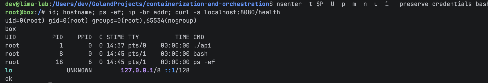

Снаружи тот же процесс:

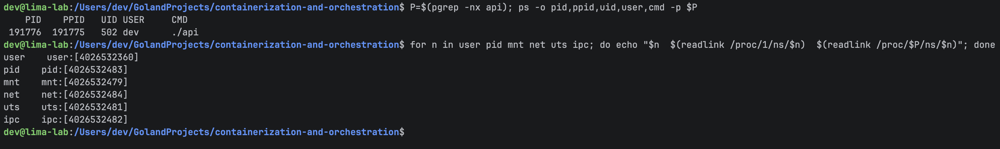

`exec` нужен, чтобы bash заменил себя на `api` — тогда `api` становится PID 1, а не ребёнком bash. `ip link set lo up` — иначе внутри не работает даже localhost.

Итог:

- **изнутри** `api` — PID 1, root, hostname `box`, из сети только `lo`, других процессов не видно;
- **снаружи** это обычный процесс с большим PID и uid 502, и все его namespaces новые (номера 40265324xx вместо хостовых 40265318xx);
- на хосте `curl localhost:8080` ответил старый хостовый `api`. Два процесса слушают 8080 одновременно без конфликта, потому что таблица портов у каждого net namespace своя. До `api` в namespace с хоста вообще не достучаться — нет veth;
- у bash, в который зашёл через `nsenter`, PPID 0: его родитель (`nsenter`) живёт в хостовом PID namespace, изнутри его не видно. `nsenter`/`docker exec` не создают namespace'ы, а подселяют в существующие;
- root внутри — не настоящий root. Права на файлы ядро проверяет по реальному uid 502. В свою папку писать могу (она моя, внутри файл будет `root`, на хосте `dev`), а `/etc/shadow` прочитать нет — он хостового root, хоть он и виден (mount namespace — копия).

## Часть 3 — cgroups

Namespaces решают, что процесс **видит**, а cgroups — сколько он **может взять**. В cgroup v2 это просто папка в `/sys/fs/cgroup`: создал каталог, записал лимиты в файлы, закинул PID в `cgroup.procs` — и процесс со всеми детьми под лимитами. `resources.limits` в Kubernetes в итоге превращаются ровно в эти файлы.

Делал через `sudo`, потому что корень `/sys/fs/cgroup` принадлежит root:

```bash
CG=/sys/fs/cgroup/lab1; sudo mkdir -p $CG
echo 100M | sudo tee $CG/memory.max            # память — 100 МБ
echo 0 | sudo tee $CG/memory.swap.max          # без свопа, чтобы не «спасался» в него
echo "50000 100000" | sudo tee $CG/cpu.max     # 50 мс из каждых 100 мс = пол-ядра
echo 20 | sudo tee $CG/pids.max                # не больше 20 процессов/потоков
```

Запуск `api` внутри cgroup — шелл кладёт **себя** в `cgroup.procs` и через `exec` превращается в `api` (дети наследуют cgroup родителя):

```bash
bash -c "echo \$\$ | sudo tee $CG/cgroup.procs >/dev/null; exec ./api"
```

### Память → OOM

`/eat?mb=50` прошёл, на `/eat?mb=80` процесс убили — в сумме 130 МБ больше лимита 100 МБ:

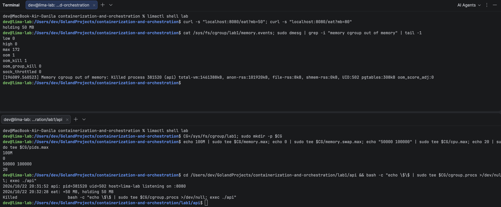

- в `memory.events`: `oom_kill 1` — ядро убило один процесс, `max 172` — столько раз упирались в лимит (до убийства ядро пыталось отжать память);
- в `dmesg`: `Memory cgroup out of memory: Killed process ... (api) anon-rss:101920kB` — убил именно **cgroup OOM**, а не глобальный, и как раз на ~100 МБ;
- остальная VM вообще ничего не заметила. Это то же самое, что `OOMKilled` в Kubernetes.

Зачем `memory.swap.max = 0`: со свопом ядро не убило бы процесс сразу, а начало бы выгружать его память на диск. Процесс жив, но тормозит в разы, и всё равно упадёт, когда кончится лимит свопа. Убить сразу честнее и предсказуемее, поэтому Kubernetes по умолчанию тоже работает без свопа.

### CPU → throttling

`/burn` хочет целое ядро, а лимит пол-ядра:

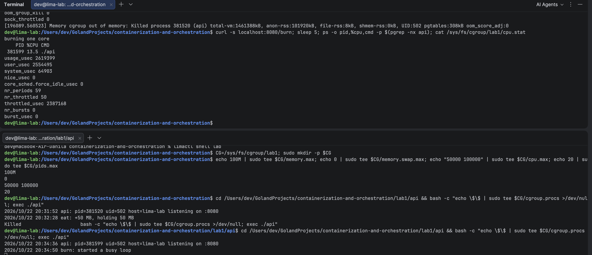

В `cpu.stat`: из 59 периодов по 100 мс процесс был придушен в 50 (`nr_throttled 50`), суммарно простоял на паузе ~2.4 с (`throttled_usec 2387168`). Процесс не убивают, его просто останавливают до следующего периода — поэтому при throttling сервис не падает, а начинает тупить (растёт latency).

`%CPU` в `ps` показал 13.5, а не 50. Это не баг: `ps` делит всё CPU-время процесса на **всё время его жизни**, а не показывает «прямо сейчас». `api` стартовал в 20:34:36, `/burn` пришёл в 20:34:50, смотрел я ещё через 5 с. Жил ~19 с, из них 14 с спал и 5 с жёг по пол-ядра ≈ 2.5 с CPU → 2.5 / 19 ≈ 13%. Для лимитов честнее смотреть `cpu.stat` (или `top`, который считает за последние секунды).

### Форк-бомба → pids.max

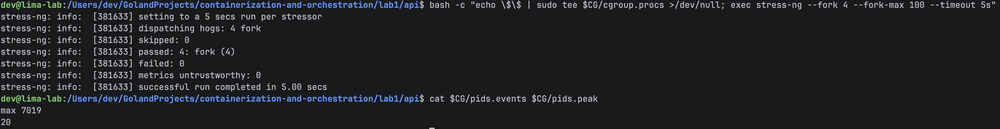

`pids.peak 20` — больше 20 процессов так и не набралось, `max 7019` — столько раз ядро отказало в `fork()`. VM при этом жива. Без лимита форк-бомба забила бы таблицу процессов всей машины.

Подвох: `pids.max` считает не процессы, а **задачи ядра**, то есть и потоки тоже. Go-рантайм сам держит несколько потоков, JVM — десятки (GC, JIT, пулы). Поэтому слишком маленький `pids.max` может уронить обычный сервис, который вообще ничего не форкает — он просто не сможет создать поток.

## Часть 4 — права

Namespaces прячут, cgroups ограничивают объём, а тут ограничиваем, **что процесс вообще может сделать**. Два отдельных механизма.

### Capabilities

Обычный root время менять может, а тот же root, у которого из bounding set выкинут `CAP_SYS_TIME`, — уже нет:

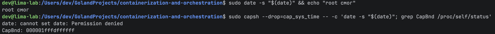

```bash
sudo capsh --drop=cap_sys_time -- -c 'date -s "$(date)"; grep CapBnd /proc/self/status'
```

`CapBnd` был `000001ffffffffff`, стал `000001fffdffffff` — пропал ровно один бит (25-й, это `CAP_SYS_TIME`). Ядро проверяет не «uid == 0», а конкретный бит, поэтому root без бита — не может. Docker делает так же, только оставляет контейнеру ~14 capabilities из 41 и выкидывает всё опасное (`SYS_ADMIN`, `SYS_TIME`, `SYS_MODULE`, ...).

### Seccomp

Seccomp — фильтр системных вызовов: процесс зовёт функцию ядра, а фильтр отвечает «нельзя» ещё до того, как ядро начнёт её выполнять. Навесил через `systemd-run` (systemd сам умеет ставить seccomp) запрет на `unshare`, `setns`, `mount` — ровно то, чем я строил «контейнер» в части 2:

```bash
sudo systemd-run --quiet --wait --pipe --collect --uid=dev \
  -p SystemCallFilter="~unshare setns mount" -p SystemCallErrorNumber=EPERM \
  bash -c 'grep Seccomp /proc/self/status; unshare -Ur true; mkdir -p /tmp/x && echo "mkdir работает"'
```

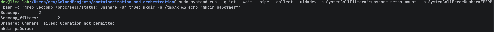

`Seccomp: 2` — включён режим фильтра. `unshare` получил `Operation not permitted`, а `mkdir`, который не запрещали, работает.

### Что закрывает каждый механизм

- **Capabilities** — проверяют, разрешено ли **привилегированное действие** (менять время, монтировать, грузить модули ядра). Режу именно **bounding set**: это потолок, его нельзя поднять обратно, даже запустив setuid-бинарник вроде `sudo`. Если убрать capability только из effective, она останется в permitted и процесс сможет включить её себе обратно.
- **Seccomp** — режет **сами системные вызовы**, ещё до их выполнения, причём любые, а не только привилегированные. Это важно, потому что дыры бывают и в коде вызовов, которым никакие права не нужны. Меньше доступных вызовов — меньше поверхность атаки на ядро.
- Зачем контейнеру запрещать `unshare`/`mount`, если он и так в своих namespaces: `unshare` (создать себе user namespace и получить в нём `CAP_SYS_ADMIN`) — классический первый шаг эксплойтов побега из контейнера (например CVE-2022-0185). Нет вызова — до уязвимого кода не добраться.

Нужны оба: capabilities не закроют непривилегированные вызовы, а seccomp не различает, *кто* зовёт — только *что*.

## Часть 5 — свой Docker (`mydocker.sh`) против `docker run`

Собрал всё из частей 2–4 в один скрипт: [`mydocker.sh`](mydocker.sh).

```bash
./mydocker.sh run box                 # запустить api в «контейнере»
./mydocker.sh exec box curl -s localhost:8080/health   # как docker exec (через nsenter)
```

Что он делает по порядку:

1. **cgroup** `/sys/fs/cgroup/mydocker-box` с лимитами памяти, CPU и pids (часть 3), при выходе удаляет её;
2. шелл кладёт себя в cgroup и делает `exec unshare --user --map-root-user --pid --fork --mount-proc --net --uts --ipc` — свои namespaces (часть 2);
3. внутри: hostname, поднять `lo`;
4. последним шагом `setpriv --bounding-set=-all --inh-caps=-all --no-new-privs --seccomp-filter seccomp.bpf ./api` — пустые capabilities, запрет повышать права и seccomp (часть 4).

Seccomp навешивается **последним**, после `unshare` и `mount` — иначе профиль запретил бы мой же `unshare`. Поэтому не через `systemd-run`, как в части 4, а через `setpriv`. `setpriv` понимает только скомпилированный BPF, а профиль у меня в формате Docker — [`seccomp.json`](seccomp.json) (запрещает `unshare`, `setns`, `mount`, `ptrace`, загрузку модулей, `bpf`, `keyctl` и т. п.). Чтобы один и тот же профиль работал и в скрипте, и в `docker run`, написал маленький конвертер [`seccompgen`](seccompgen/main.go): JSON → BPF.

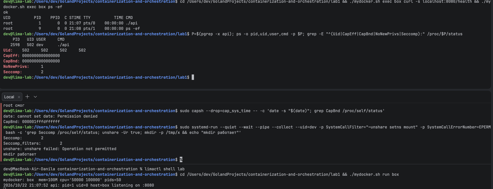

Внутри `api` — PID 1 и `/health` отвечает. Снаружи: uid 502, `CapBnd` из нулей, `NoNewPrivs: 1`, `Seccomp: 2`.

Тот же бинарник, те же лимиты и тот же seccomp-профиль через Docker:

```bash
docker run -d --name api-docker -v $PWD/api:/app:ro --memory 100m --cpus 0.5 --pids-limit 50 \
  --security-opt seccomp=$PWD/seccomp.json -p 8081:8080 busybox /app/api
```

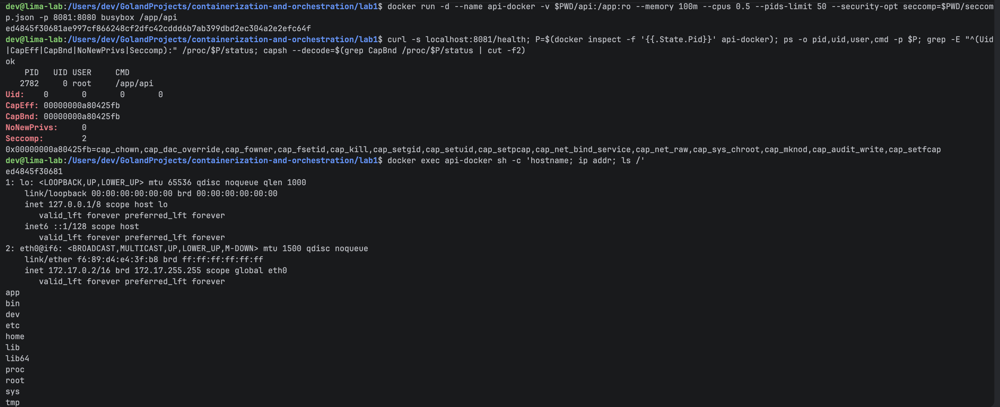

### Сравнение

| | `mydocker.sh` | `docker run` |
|---|---|---|
| pid, mount, net, uts, ipc namespaces | ✅ | ✅ |
| user namespace | ✅ root внутри = uid 502 снаружи | ❌ по умолчанию нет — **снаружи настоящий root (uid 0)** |
| cgroup namespace | ❌ процесс видит путь своей cgroup на хосте | ✅ внутри `/proc/1/cgroup` = `0::/` |
| лимиты cgroup | ✅ сам пишу в файлы | ✅ те же файлы, только в `system.slice/docker-<id>.scope` |
| capabilities | 0 из 41 | 14 из 41 (`chown`, `setuid`, `net_bind_service`, `kill`, ...) |
| no_new_privs | ✅ | ❌ (включается `--security-opt no-new-privileges`) |
| seccomp | ✅ мой профиль | ✅ мой профиль (без `--security-opt` — встроенный дефолтный) |
| своя файловая система | ❌ виден весь хост | ✅ корень из образа (`ls /` — это busybox) через overlayfs + `pivot_root` |
| сеть | ❌ только `lo`, снаружи не достучаться | ✅ veth `eth0` → мост `docker0`, IP 172.17.0.2, NAT наружу и `-p 8081:8080` внутрь |
| образы, логи, рестарты, `docker ps` | ❌ | ✅ |

### Выводы

- **Главное отличие — uid снаружи.** У Docker `api` на хосте — настоящий root. Если через баг ядра процесс сбежит из контейнера, он окажется root на хосте. Мой скрипт за счёт user namespace сбежит максимум как обычный юзер 502.
- **Почему Docker не включает user namespace по умолчанию:** ломаются тома. С маппингом `0 100000 65536` файл, созданный root в контейнере, на хосте принадлежит uid 100000, а хостовый файл юзера 1000 (которого нет в маппинге) внутри выглядит как `nobody` и не пишется. Поэтому user namespace включают явно — `userns-remap` или rootless Docker.
- **Почему у Docker 14 capabilities, а не 0:** обычным образам они нужны. Например, nginx/postgres стартуют от root и сами переключаются на непривилегированного юзера (`CAP_SETUID`/`CAP_SETGID`), меняют владельца своих файлов (`CAP_CHOWN`, `CAP_FOWNER`), nginx слушает порт 80 (`CAP_NET_BIND_SERVICE`). Опасное (`SYS_ADMIN`, `SYS_MODULE`, `SYS_TIME`) Docker выкидывает. Мне для `api` не нужно ничего — поэтому 0.
- **Сеть у Docker:** `eth0` в контейнере — конец veth-пары (`eth0@if6` = «моя пара — интерфейс №6 на хосте»), второй конец воткнут в мост `docker0` (172.17.0.1 — шлюз контейнера). Наружу — NAT (masquerade) подменяет 172.17.0.2 на адрес хоста. Внутрь — `-p 8081:8080` это DNAT-правило (плюс `docker-proxy` для localhost), которое превращает `localhost:8081` в `172.17.0.2:8080`. У моего скрипта этого нет — только `lo`.
- **Файловая система:** Docker даёт контейнеру корень из образа (overlayfs + `pivot_root`), а мой скрипт оставляет хостовую ФС — это и есть то, чего не хватает (часть 6).

## Часть 6 — образы

В части 5 моему скрипту не хватало своей файловой системы — её и даёт образ. Образ — это набор слоёв (по сути tar-архивы), overlayfs складывает их в один корень, и контейнер получает его через `pivot_root`. Каждая инструкция Dockerfile, которая меняет файлы, — новый слой.

Два Dockerfile:

- [`api/Dockerfile.single`](api/Dockerfile.single) — одна стадия на `golang:1.25-alpine`, весь тулчейн Go остаётся в образе;
- [`api/Dockerfile`](api/Dockerfile) — **multi-stage**: собираю в образе с Go, а в итоговый `scratch` (пустой образ) кладу только статический бинарник + `USER 65534` (не root).

### Размер и слои

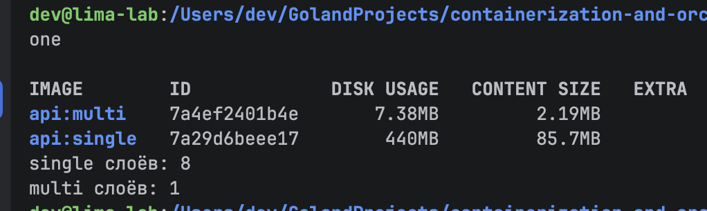

| | single | multi (scratch) |
|---|---|---|
| размер | 440 МБ | 7.4 МБ (2.2 МБ сжатый — столько качает `docker pull`) |
| слоёв | 8 | 1 |
| внутри | alpine + весь Go + исходники + бинарник | только бинарник |

### Кэш

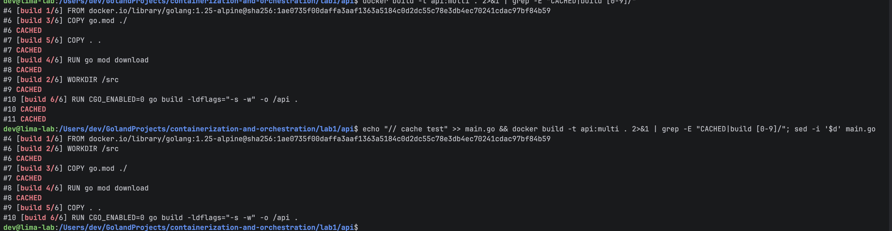

- пересобрал без изменений — все шаги `CACHED`;
- дописал комментарий в `main.go` — `COPY go.mod` и `go mod download` остались `CACHED`, а `COPY . .` и `go build` выполнились заново.

Поэтому в Dockerfile сначала `COPY go.mod` + `go mod download`, а уже потом `COPY . .`: зависимости меняются редко, код — постоянно.

### Запуск, scratch и тома

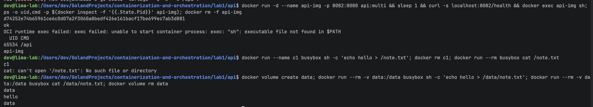

- `/health` отвечает, процесс снаружи — uid 65534, не root;
- `docker exec ... sh` → `sh: not found`: в образе вообще ничего нет, кроме бинарника;
- записал файл в контейнер, удалил контейнер, запустил новый — файла нет. С томом `-v data:/data` — файл на месте.

### Что понял

- **Куда делись слои сборки.** Итоговый образ собирается только из инструкций после последнего `FROM` (`FROM scratch`, `COPY --from=build`, `USER`, `ENTRYPOINT`). Стадия `build` — временный образ, нужный только чтобы скопировать из него бинарник, в итоговый образ её слои не попадают. Поэтому 1 слой.
- **Зачем образ без `sh`.** Если в `api` найдут дыру и смогут выполнить код в контейнере, атакующему просто нечем работать: нет шелла, `curl`, пакетного менеджера, нечего скачать и запустить. Плюс меньше файлов — меньше CVE в сканерах.
- **Как работает кэш.** Слой берётся из кэша, если совпадает инструкция, для `COPY` — содержимое копируемых файлов, и все слои до него тоже из кэша. Как только один слой пересобрался — все следующие пересобираются. Если бы `COPY . .` стоял до `go mod download`, любая правка кода заново выкачивала бы все зависимости (при сотнях пакетов — минуты на каждую сборку).
- **Почему файл пропал.** Слои образа read-only и общие для всех контейнеров. Каждому контейнеру overlayfs добавляет сверху свой **writable-слой** — туда и записался `note.txt`. `docker rm` удаляет контейнер вместе с этим слоем. Том — не слой, а обычная папка на хосте (`/var/lib/docker/volumes/data/_data`), примонтированная в контейнер в обход overlayfs, поэтому живёт отдельно от контейнера.

## Часть 7 — gVisor

Всё из частей 2–6 — это ограничения, которые **ядро хоста** накладывает само на себя. Любой системный вызов контейнера всё равно выполняет ядро хоста. gVisor устроен по-другому: между приложением и ядром ставится **своё ядро на Go, работающее в user space** (Sentry). Системные вызовы приложения перехватывает и обрабатывает Sentry, а до настоящего ядра доходит только небольшой набор его собственных вызовов.

Поставил в VM `runsc` (из официального релиза gVisor), зарегистрировал в Docker как рантайм (`runsc install`), дальше просто `docker run --runtime=runsc`.

### Какое ядро видит контейнер

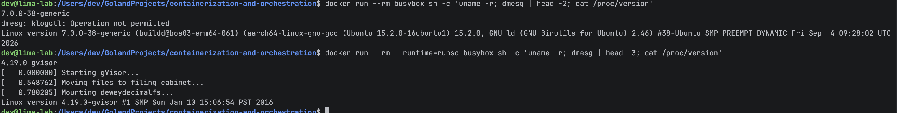

| | runc (обычный Docker) | runsc (gVisor) |
|---|---|---|
| `uname -r` | `7.0.0-38-generic` — ядро хоста | `4.19.0-gvisor` — «ядро» Sentry |
| `dmesg` | запрещён (нет прав читать лог ядра хоста) | шуточный лог Sentry: «Starting gVisor... Mounting deweydecimalfs...» |
| кто выполняет syscalls | ядро хоста | Sentry, в ядро хоста — только его узкий набор вызовов |

### `api` под gVisor и вид с хоста

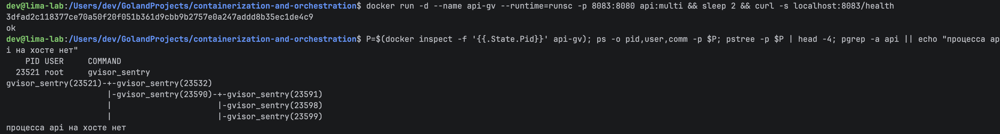

`/health` отвечает, но **процесса `api` на хосте нет**: с хоста видно только дерево `gvisor_sentry`. `api` живёт внутри Sentry как процесс внутри маленькой «ОС». С обычным Docker и моим скриптом `api` на хосте — обычный процесс, которого видно в `ps`.

### Выводы

- **Что у обычного контейнера всегда общее с хостом — ядро.** Одно на хост и все контейнеры. Namespaces, cgroups, capabilities, seccomp — это функции того же самого ядра, оно ограничивает само себя. Поэтому любой баг в ядре, до которого можно достучаться системным вызовом, — это побег сразу из всех контейнеров. Это и есть предел контейнерной изоляции: лучше, чем ядро, контейнер не защитить. Дальше — только своё ядро: gVisor или виртуалка.
- **Почему gVisor изолированнее.** У обычного контейнера кривой syscall сразу попадает в код ядра хоста. У gVisor его обрабатывает Sentry — обычный процесс на хосте, на Go (без типичных для C ошибок памяти), сам зажатый строгим seccomp с маленьким набором разрешённых вызовов. Нашёл баг в обработке syscall — оказался внутри Sentry, а не в ядре. Чтобы добраться до хоста, нужно ещё пробить Sentry и потом найти дыру в том узком наборе вызовов, которые ему разрешены.
- **Цена.** Скорость — каждый syscall проходит лишний слой, особенно страдают I/O и сеть. Совместимость — Sentry это «ненастоящее» ядро, не все syscalls и фичи реализованы (часть `/proc`, eBPF, некоторые `ioctl`), что-то может не завестись.
- **Где нужен.** Когда запускаешь **чужой код, которому не доверяешь**: CI-раннеры, собирающие чужие PR, serverless и песочницы, где пользователи запускают свой код (так работает, например, GKE Sandbox). Для своих доверенных сервисов обычно хватает обычного контейнера.

## Часть 8 — мониторинг

Те же cgroup-файлы, что я читал руками в части 3 (`memory.events`, `cpu.stat`, `pids.*`), **cAdvisor** читает для всех контейнеров и отдаёт как метрики, **Prometheus** собирает их каждые 5 секунд, **Grafana** рисует. В Kubernetes то же самое — cAdvisor встроен в kubelet.

Стек — [`monitoring/compose.yaml`](monitoring/compose.yaml): `api` с теми же лимитами (100 МБ, пол-ядра, 50 pids, `restart: unless-stopped`), cAdvisor, Prometheus ([`prometheus.yml`](monitoring/prometheus.yml), [`alerts.yml`](monitoring/alerts.yml)) и Grafana с готовым дашбордом ([`api.json`](monitoring/grafana/dashboards/api.json)).

```bash
cd monitoring && docker compose up -d --build     # Grafana: http://localhost:3000, Prometheus: :9090
```

Грабли: cAdvisor v0.52 не видел контейнеры (`failed to identify the read-write layer ID`) — Docker 29 по умолчанию хранит образы через containerd snapshotter, а старый cAdvisor ищет слои по старому пути `/var/lib/docker/image/overlayfs/...`. Помогла свежая версия `ghcr.io/google/cadvisor:v0.60.6`.

Нагрузка: `/burn` на полторы минуты, потом `/eat` до ~90% лимита на 40 секунд и добил до OOM.

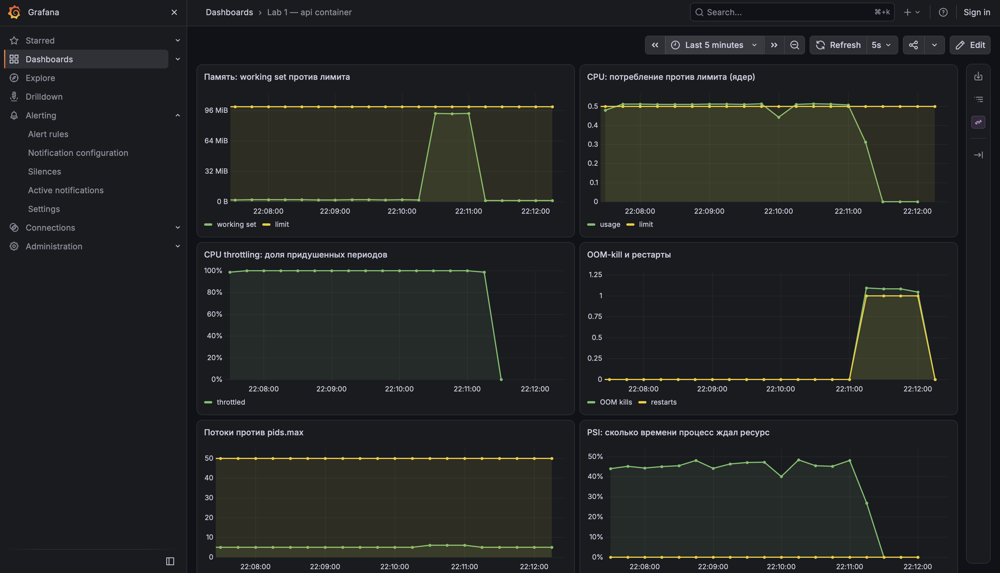

Что видно:

- **CPU** упёрся ровно в лимит 0.5 ядра, а **throttling** всё это время 100% — каждый период процесс хотел больше и его ставили на паузу;
- **PSI** — ~45% времени процесс ждал CPU (pressure stall information, ядро само считает, сколько задачи простаивали в ожидании ресурса);
- **память** поднялась до ~94 МБ при лимите 100 МБ, потом **OOM-kill** и **рестарт** одновременно, после рестарта всё обнулилось (и `/burn` умер вместе со старым процессом);
- **потоки** — 5–6 из 50 разрешённых `pids.max`.

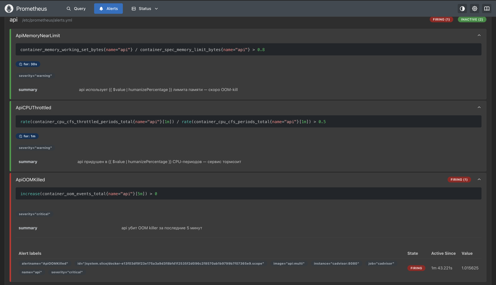

`ApiOOMKilled` горит. Два других к моменту скриншота уже погасли — после рестарта нагрузки не стало.

### Три алерта

| Алерт | Условие | Что ловит | Чем грозит |
|---|---|---|---|
| `ApiMemoryNearLimit` | working set > 80% лимита 30 с | память подходит к лимиту | следующий шаг — OOM-kill и падение сервиса. Это **предупреждение заранее**: можно поднять лимит, найти утечку, перезапуститься в удобный момент |
| `ApiCPUThrottled` | throttled-периодов > 50% за 1 мин | сервис хочет больше CPU, чем ему дали, и ядро ставит его на паузу | запросы ждут конца паузы — растёт latency, пользователи видят тормоза, хотя сервис «живой» |
| `ApiOOMKilled` | рост `container_oom_events_total` за 5 мин | контейнер уже убит OOM killer | сервис падал, запросы в этот момент обрывались, состояние в памяти потеряно. Если повторяется — рестарт-луп |

Почему именно эти:

- **Память 80% и OOM — пара «до» и «после».** Первый — «скоро будет плохо», второй — «уже плохо». Одного OOM-алерта мало: узнаешь, только когда сервис уже упал.
- **Throttling, а не CPU usage.** Usage = 0.5 показывает только, сколько процесс *получил*, — это может значить и «ему как раз хватает», и «он хочет 4 ядра, но его режут». Доля throttled-периодов показывает именно «хотел больше, а его останавливали». Процесс при этом не убивают и не рестартят — он просто стоит на паузе до следующего периода в 100 мс, отсюда тормоза.
- **Почему у OOM нет `for:`.** `for: 30s` значит «условие должно держаться 30 секунд подряд» — так отсекаются короткие всплески CPU и памяти, это нормальная работа, а не авария. OOM-kill — событие, которое уже случилось и само не «пройдёт», ждать нечего.
- **Что на дашборде, но не в алертах:** потоки против `pids.max` (у нас 5 из 50 — запас огромный, алерт был бы шумом) и PSI (полезно для разбора, почему тормозит, но throttling уже ловит основной случай).
