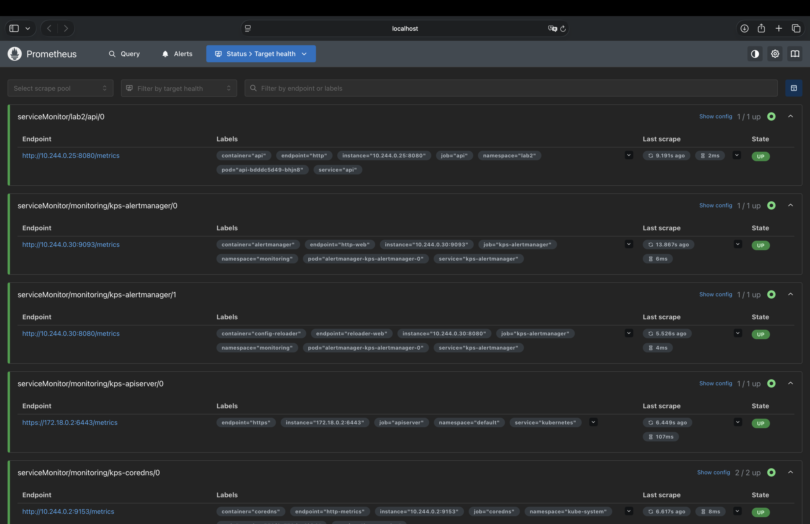
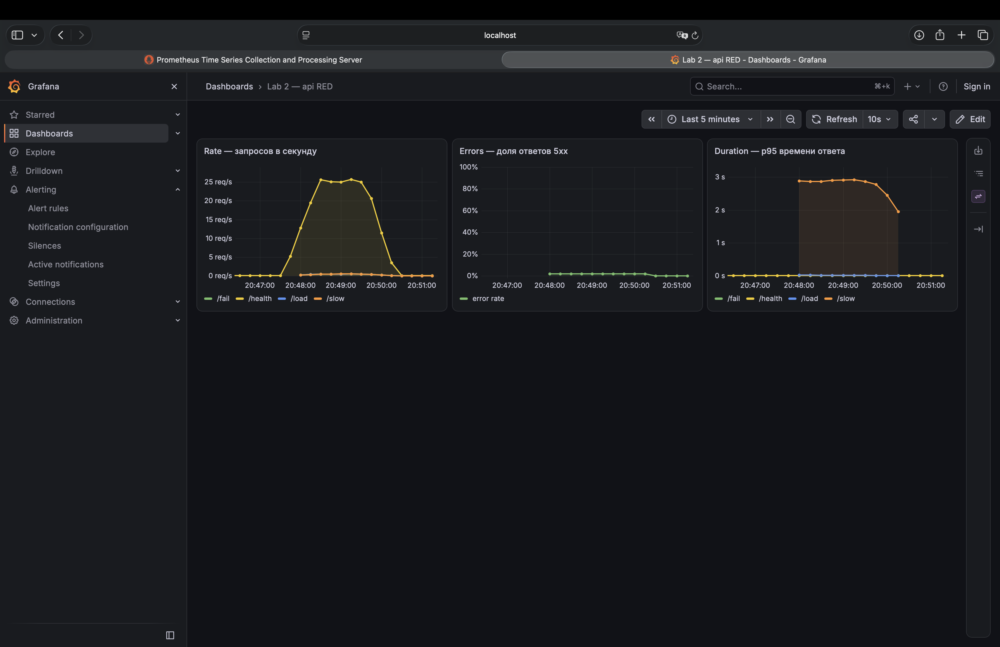
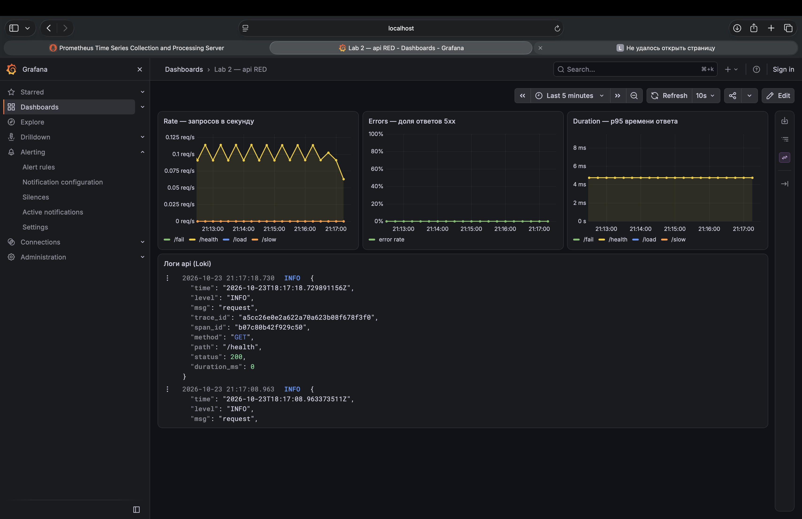
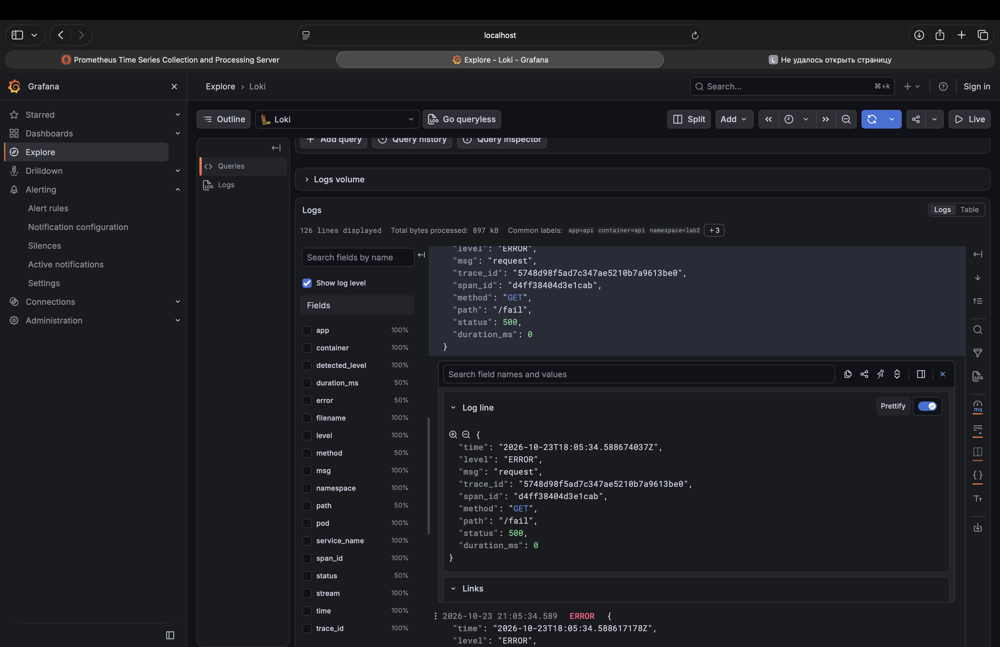

# Лаба 2 — мониторинг сервиса: метрики, логи, трейсы

Всё в Kubernetes, всё через Helm. Кластер — kind (одна нода, Kubernetes 1.37) в той же Lima VM, что и в лабе 1 (теперь у неё 8 ГБ памяти — стек мониторинга прожорливый).

Что где лежит:

- [`api/`](api/main.go) — сервис на Go + [`Dockerfile`](api/Dockerfile);
- [`charts/api/`](charts/api/values.yaml) — мой Helm-чарт для сервиса. Мониторинг сервиса в нём включается флагами по частям: ServiceMonitor, дашборд, панель логов, адрес для трейсов, правила алертов;
- [`charts/alert-receiver/`](charts/alert-receiver/templates/receiver.yaml) — получатель алертов (часть 4);
- [`helm/`](helm/) — values для чартов стека: kube-prometheus-stack, Loki, Alloy, Jaeger, Karma.

## Часть 0 — сервис

Сервис на Go (сгенерирован, на оценку не влияет):

| Эндпоинт | Что делает |
|---|---|
| `/health` | `ok` |
| `/fail` | 500 + счётчик ошибок, спан помечается ошибочным |
| `/slow` | спит 1–3 с во вложенном спане `slow-op` |
| `/load?n=50` | шлёт N запросов к своему `/health`, чтобы подскочил RPS |
| `/metrics` | метрики Prometheus |

Метрики по RED: `http_requests_total{path,code}` (Rate), `http_request_errors_total{path}` (Errors), гистограмма `http_request_duration_seconds{path}` (Duration). Логи — JSON в stdout, в каждой строке `trace_id` и `span_id`. Трейсы — OpenTelemetry, `otelhttp` создаёт корневой спан на каждый запрос, адрес экспорта берётся из `OTEL_EXPORTER_OTLP_ENDPOINT`.

Собрал образ и закинул в kind (нода kind — отдельный контейнер со своим containerd, образы из моего Docker она не видит):

```bash
docker build -t api:lab2 api && kind load docker-image api:lab2 --name lab
kubectl create ns lab2 && helm install api charts/api -n lab2 --wait
```

## Часть 1 — метрики (Prometheus + Grafana)

Поставил **kube-prometheus-stack** — в нём Prometheus Operator, Prometheus, Alertmanager, Grafana, node-exporter и kube-state-metrics. Values — [`helm/kube-prometheus-stack.yaml`](helm/kube-prometheus-stack.yaml):

- выключил скрейп etcd/scheduler/controller-manager/kube-proxy — в kind они снаружи недоступны и только сыпали бы ошибками;
- выключил ~150 встроенных правил алертов — в Alertmanager будут только мои;
- `serviceMonitorSelectorNilUsesHelmValues: false` (и то же для правил) — иначе Prometheus подхватывает только ServiceMonitor'ы со своим лейблом релиза, а мой лежит в другом чарте и namespace.

```bash
kubectl create ns monitoring
helm install kps prometheus-community/kube-prometheus-stack --version 92.11.0 -n monitoring -f helm/kube-prometheus-stack.yaml --wait
helm upgrade api charts/api -n lab2 --reuse-values --set serviceMonitor.enabled=true --set dashboard.enabled=true
```

Scrape-конфиг Prometheus руками я не писал. В чарте `api` есть **ServiceMonitor** ([`servicemonitor.yaml`](charts/api/templates/servicemonitor.yaml)) — «скрейпь порт `http` у сервисов с лейблом `app.kubernetes.io/name: api`, путь `/metrics`». Оператор видит этот ресурс и сам дописывает job в конфиг Prometheus.



Таргет `serviceMonitor/lab2/api/0` — UP.

Дашборд RED лежит в чарте как ConfigMap с лейблом `grafana_dashboard: "1"` ([`dashboard.yaml`](charts/api/templates/dashboard.yaml)) — sidecar Grafana находит такие ConfigMap'ы во всех namespace и сам загружает. Нагрузка — пару минут `/load`, `/fail`, `/slow` вперемешку:



- **Rate** — `sum by (path) (rate(http_requests_total[1m]))`, подскочил до ~25 req/s (это `/health` от `/load`);
- **Errors** — доля 5xx от всех запросов;
- **Duration** — p95 из гистограммы: `histogram_quantile(0.95, sum by (le, path) (rate(http_request_duration_seconds_bucket[1m])))`, у `/slow` ~3 с.

### Что понял

- **Почему таргет — адрес пода, а не Service.** Prometheus через ServiceMonitor берёт список адресов подов за сервисом (Endpoints) и скрейпит каждый под отдельно. Через Service каждый раз отвечал бы случайный под — счётчики разных подов перемешались бы, `rate` скакал бы, а упавший под вообще не было бы видно. С `replicas: 3` будет 3 таргета.
- **Почему p95, а не среднее.** 100 запросов `/health` по 1 мс и 2 запроса `/slow` по 2 с дают среднее ~40 мс — выглядит отлично, а два пользователя ждали по 2 секунды. p95 = «95% запросов быстрее этого», он показывает, как живут самые медленные. Поэтому время ответа пишется гистограммой (счётчики по корзинам `le`), а квантиль считается уже в Prometheus.
- **Почему ошибок всего ~2%.** Error rate = ошибки в секунду / все запросы в секунду. За цикл в 2 секунды: `/load` (а внутри него ещё 50 `/health`), `/fail`, `/slow` — 1 ошибка из 53 ≈ 1.9%. Массовые «здоровые» запросы разбавляют долю ошибок — это надо учитывать в пороге алерта.

## Часть 2 — логи (Loki + Alloy)

Разделение ролей:

- **Loki** — только хранилище логов, сам ниоткуда ничего не забирает. Поставил одним процессом (SingleBinary), хранение на диске пода — [`helm/loki.yaml`](helm/loki.yaml);
- **Alloy** — агент сбора, **DaemonSet** (по поду на каждой ноде). Читает файлы логов контейнеров своей ноды из `/var/log/pods/...` и шлёт в Loki — [`helm/alloy.yaml`](helm/alloy.yaml).

```bash
helm install loki grafana/loki --version 7.5.0 -n monitoring -f helm/loki.yaml --wait
helm install alloy grafana/alloy --version 1.14.3 -n monitoring -f helm/alloy.yaml --wait
helm upgrade api charts/api -n lab2 --reuse-values --set dashboard.logsPanel=true
```

Что делает конфиг Alloy по шагам: находит поды **своей** ноды (`discovery.kubernetes` с фильтром по `spec.nodeName`) → вешает лейблы `namespace`, `pod`, `container`, `app` и вычисляет путь к файлу лога → читает файлы → разбирает формат CRI (время, поток, строка) → отправляет в Loki.

Loki как источник уже был прописан в Grafana (values kube-prometheus-stack), так что метрики и логи — в одной Grafana и даже на одном дашборде:



Ошибку `/fail` нашёл в Explore запросом `{namespace="lab2", app="api"} | json | level="ERROR"`:



`| json` разбирает JSON-строку прямо при запросе — поэтому видны поля `level`, `path`, `status`, `trace_id` и можно по ним фильтровать.

Грабли: в логах сыпались `traces export: Post "https://localhost:4318"... connection refused` — Go-экспортёр OpenTelemetry не понимает `OTEL_TRACES_EXPORTER=none` и без адреса долбился в localhost. Поправил в коде: если `OTEL_EXPORTER_OTLP_ENDPOINT` не задан — экспортёр не создаётся (спаны и `trace_id` в логах при этом остаются).

### Что понял

- **Как строка лога попадает в Loki.** Сервис пишет в stdout → containerd перехватывает stdout контейнера и пишет в файл на диске ноды (`/var/log/pods/<namespace>_<pod>_<uid>/<container>/0.log`, формат CRI) → Alloy на этой ноде читает файл → отправляет строки в Loki по HTTP (`/loki/api/v1/push`).
- **Почему Alloy — DaemonSet.** Файлы логов лежат на диске конкретной ноды, под с другой ноды их не прочитает — значит, агент нужен на каждой ноде. DaemonSet сам ставит ровно один под на каждую ноду и автоматически добавляет агент, когда в кластере появляется новая нода. Deployment так не умеет: планировщик раскидает реплики как попало — может выйти два агента на одной ноде и ни одного на другой, и логи с неё никто не соберёт.
- **Почему `trace_id` не лейбл.** Loki индексирует только лейблы: каждая уникальная комбинация лейблов — отдельный поток (stream) со своей записью в индексе. `trace_id` у каждого запроса свой — миллион запросов дал бы миллион потоков, индекс раздулся бы, Loki съел бы память и тормозил на каждом запросе (высокая кардинальность). Поэтому в лейблах только то, у чего мало значений (`namespace`, `app`, `pod`, `container`), а `trace_id` ищется по содержимому строки: `|= "<trace_id>"` или `| json | trace_id="..."`.
