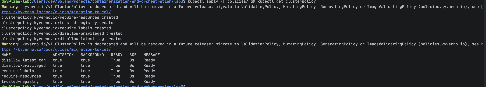
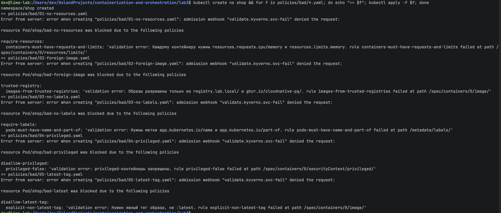
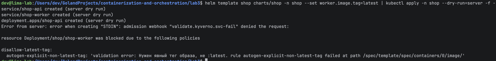
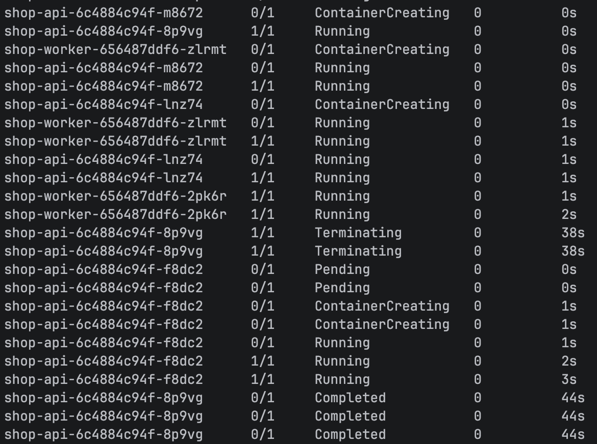
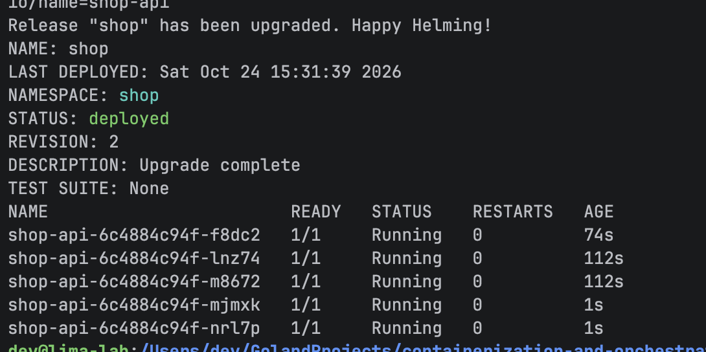
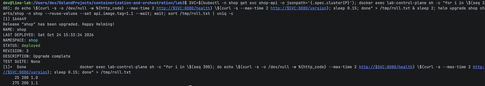
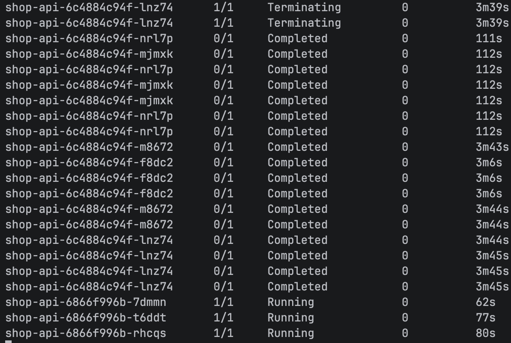
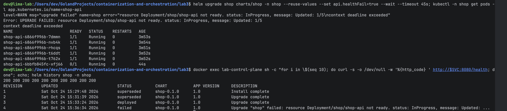
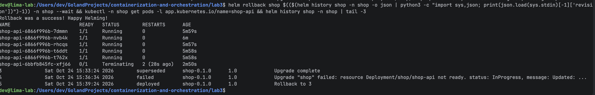

# Лаба 3 — платформа для shop

Тот же kind-кластер в Lima VM, что и в лабе 2. Стек мониторинга из лабы 2 (Prometheus, Grafana, Loki, Alertmanager) продолжает работать — в части 5 подключаюсь к нему, новый не поднимаю.

Что где лежит:

- [`services/`](services) — `api` и `worker` на Go + один [`Dockerfile`](services/Dockerfile) на оба;
- [`policies/`](policies) — 5 политик Kyverno, в [`policies/bad/`](policies/bad) — 5 манифестов-нарушителей;
- [`charts/shop/`](charts/shop) — Helm-чарт `shop`: api, worker, postgres (CloudNativePG), мониторинг;
- [`helm/kyverno.yaml`](helm/kyverno.yaml) — values для Kyverno.

## Часть 0 — сервисы

Сгенерированы, на оценку не влияют:

- **api**: `GET /health` (`ok`, а при `HEALTH_FAIL=true` — 503), `POST /order` (пишет заказ в postgres), `GET /orders` (последние 50), `GET /version`, `/metrics`;
- **worker**: раз в 2 секунды берёт необработанные заказы и помечает обработанными. `FOR UPDATE SKIP LOCKED` — чтобы две реплики worker не схватили один и тот же заказ.

Оба сервиса стартуют **без базы**: HTTP и `/health` поднимаются сразу, а к postgres подключаются в фоне, когда он появится (база заводится только в части 3). Адрес базы читается из файла — Secret `shop-db-app`, который создаёт оператор, смонтирован в под томом с `optional: true`. Пока Secret нет — файла нет, под всё равно стартует; появится — kubelet сам подложит файл, перезапускать поды не нужно.

Образы с префиксом доверенного реестра (`registry.lab.local/...`, см. политику ниже), загружаю прямо в ноду kind — реестра с таким именем на самом деле нет:

```bash
for v in 1.0 1.1; do docker build -t registry.lab.local/shop/api:$v --build-arg APP=api --build-arg VERSION=$v services; done
docker build -t registry.lab.local/shop/worker:1.0 --build-arg APP=worker --build-arg VERSION=1.0 services
for i in api:1.0 api:1.1 worker:1.0; do kind load docker-image registry.lab.local/shop/$i --name lab; done
```

## Часть 1 — ограждения на кластер

### Почему Kyverno

| | Kyverno | OPA / Gatekeeper |
|---|---|---|
| язык правил | обычный YAML, как любой манифест Kubernetes | Rego — отдельный язык, надо учить |
| порог входа | низкий: паттерн «как должен выглядеть объект» | высокий |
| гибкость | хватает для типовых правил, сложное — через CEL/JMESPath | максимальная |
| сверх валидации | умеет ещё mutate/generate | в основном валидация |

Взял **Kyverno**: правила читаются как манифесты, для локального кластера и пяти типовых правил Rego — избыточен.

Kyverno — это **admission webhook**: apiserver перед сохранением объекта отправляет его в Kyverno, и если правило нарушено — отказ, до etcd объект не доходит.

```bash
helm install kyverno kyverno/kyverno --version 3.9.2 -n kyverno --create-namespace -f helm/kyverno.yaml --wait
kubectl apply -f policies/
```

### Пять правил

| Политика | Что требует | Зачем |
|---|---|---|
| [`require-resources`](policies/01-require-resources.yaml) | у каждого контейнера `requests.cpu/memory` и `limits.memory` | без requests планировщик не знает, сколько места нужно поду; без limits один под может съесть всю ноду (часть 3 лабы 1 — cgroup) |
| [`trusted-registry`](policies/02-trusted-registry.yaml) | образы только из `registry.lab.local/` и `ghcr.io/cloudnative-pg/` | случайный образ из интернета может содержать что угодно; так в кластер попадает только проверенное |
| [`require-labels`](policies/03-require-labels.yaml) | метки `app.kubernetes.io/name` и `app.kubernetes.io/part-of` | без меток не найти владельца и не выбрать поды в Service/ServiceMonitor/NetworkPolicy |
| [`disallow-privileged`](policies/04-disallow-privileged.yaml) | никаких `privileged: true` | privileged-контейнер получает все capabilities и доступ к устройствам ноды — по сути root на ноде (лаба 1, часть 4) |
| [`disallow-latest-tag`](policies/05-disallow-latest-tag.yaml) (свой) | явный тег образа, не `:latest` | `:latest` меняется без предупреждения — непонятно, что реально запущено, и нельзя откатиться на «предыдущую версию» |

Правила написаны для `Pod`, но Kyverno сам генерирует такие же для Deployment/StatefulSet/Job (autogen) — поэтому неправильный Deployment отклоняется сразу при `apply`, а не «тихо» на этапе создания подов.

Системные namespace и уже работающая инфраструктура (`kube-system`, `monitoring` со стеком из лабы 2, сам `kyverno`, оператор БД `cnpg-system`) вынесены в `exclude` — их образы не из моего реестра, и без исключения политика не дала бы им пересоздать поды.

Kyverno 1.19 предупреждает, что `ClusterPolicy` устарел и будет заменён CEL-политиками (`ValidatingPolicy`). Пока работает, но в проде я бы сразу писал на новом API.



### Пять нарушителей

В [`policies/bad/`](policies/bad) — пять подов, каждый нарушает **ровно одно** правило (остальное в них по правилам):

```bash
kubectl create ns shop && for f in policies/bad/*.yaml; do kubectl apply -f $f; done
```



Все пять отклонены, у каждого — своя политика и путь к полю, на котором сработало правило (`/spec/containers/0/image/`, `/metadata/labels/`, ...).

### Что понял

- **Когда проверяет Kyverno.** До etcd: admission стоит между аутентификацией и сохранением объекта. Не прошёл проверку — объекта в кластере просто нет. Уже работающие поды новая политика не трогает (не убивает) — они только попадают в фоновый отчёт (PolicyReport).
- **Зачем `exclude` для инфраструктуры.** Без него упавший под Grafana (образ не из `registry.lab.local`) не смог бы пересоздаться — Deployment есть, подов 0, мониторинг лежит. Поэтому системные namespace исключают или явно добавляют их реестры в доверенные.
- **Почему важен autogen (правила и для Deployment).** Если бы проверялись только поды: Deployment принят → контроллер ReplicaSet пытается создать поды → вебхук отказывает *контроллеру*, а не мне. `helm install --wait` просто висит до таймаута, подов 0, а причина видна только в events ReplicaSet (`FailedCreate ... denied the request`). С autogen отказ приходит сразу на `apply`/`helm install`.

## Часть 2 — чарт `shop`

Чарт — [`charts/shop`](charts/shop): `Chart.yaml`, [`values.yaml`](charts/shop/values.yaml) (api — 3 реплики, worker — 2), шаблоны [`api.yaml`](charts/shop/templates/api.yaml) и [`worker.yaml`](charts/shop/templates/worker.yaml) (Deployment + Service), readiness- и liveness-пробы на `/health`. Под политики из части 1 заложено сразу (общие куски — в [`_helpers.tpl`](charts/shop/templates/_helpers.tpl)):

- метки `app.kubernetes.io/name` + `app.kubernetes.io/part-of: shop`;
- `requests`/`limits` из values;
- образы `registry.lab.local/...` с явным тегом;
- `securityContext`: `privileged: false`, не root, без повышения прав, read-only ФС, `drop: [ALL]`.

### Политика ловит и чарт

Прогнал чарт с `worker.image.tag=latest` через server-side dry-run (объекты не создаются, но admission проходит по-настоящему):

```bash
helm template shop charts/shop -n shop --set worker.image.tag=latest | kubectl apply -n shop --dry-run=server -f -
```



Отклонён сам Deployment `shop-worker`, правилом `autogen-explicit-non-latest-tag` — это правило Kyverno сгенерировал из моего правила для Pod. С правильными значениями `helm install` прошёл чисто, без единого отказа.

### Reconciliation

Kubernetes постоянно сравнивает желаемое состояние (spec) с реальным и чинит разницу.

Удалил под `api` руками — ReplicaSet увидел 2 вместо 3 и сразу создал новый:



`helm upgrade --set api.replicas=5` — подов стало 5:



### Rolling update без потерь

В Deployment `api` — `strategy: RollingUpdate` с `maxSurge: 1, maxUnavailable: 0`: сначала поднимается **новый** под, и только когда он прошёл readiness — гасится один старый. Рабочих подов никогда не становится меньше нужного.

Запросы шли **изнутри ноды на ClusterIP** сервиса (`docker exec lab-control-plane curl ...`), а не через port-forward — port-forward привязан к одному поду и рвётся, когда этот под заменяют. 300 запросов `/health` + `/version`, параллельно `helm upgrade --set api.image.tag=1.1`:



Ни одного не-200: 25 ответов от старой 1.0, 275 — от новой 1.1. Поды менялись по одному (у новых возраст 80, 77, 62 с — поднимались друг за другом, старые уходили в `Completed`):



Грабли: при первом прогоне 1 запрос из 200 всё-таки потерялся. Когда под удаляют, параллельно и несинхронно идут две вещи: (а) kubelet шлёт процессу SIGTERM — `api` закрывает порт; (б) под убирают из Endpoints, и kube-proxy на каждой ноде переписывает iptables (~секунда). Если (а) успело раньше (б) — в этот промежуток новые запросы ещё идут на под с закрытым портом → `connection refused`. Лечится `lifecycle.preStop: sleep 5` — он выполняется **до** SIGTERM: процесс ещё 5 секунд слушает порт и отвечает, а kube-proxy за это время успевает убрать под из маршрутов. После этого — ни одного потерянного запроса.

### Сломанная версия и rollback

`helm upgrade --set api.healthFail=true` — новые поды отвечают на `/health` 503:



- rollout застрял на `Updated: 1/5`: новый под `0/1` (не проходит readiness), а **все 5 старых остались `1/1`** — их не трогают, пока новый не станет Ready;
- сервис всё это время отвечает `200`;
- helm по таймауту пометил ревизию 4 как `failed`.

`helm rollback shop 3` — кластер вернулся к рабочей ревизии, появилась ревизия 5 `Rollback to 3`:



### Что понял

- **readiness vs liveness.** Обе пробы выполняет **kubelet** на ноде, обе смотрят на `/health`, но последствия разные. Провалилась **readiness** → `Ready=false` → под убирают из Endpoints сервиса, трафик на него не идёт, контейнер не трогают. Провалилась **liveness** (у нас 6 раз подряд по 10 с) → kubelet **перезапускает контейнер** — поэтому у сломанного пода `RESTARTS 2`. Readiness — «можно ли слать трафик», liveness — «жив ли процесс или его пора перезапустить».
- **Почему сломанная версия не уронила сервис.** Две настройки вместе: **readiness-проба** (сломанный под так и не стал Ready) и **`maxUnavailable: 0`** (Deployment не имеет права гасить старый под, пока новый не Ready). Новый не готов → старые не трогаются → rollout просто стоит, сервис работает на старых. Без readiness Kubernetes считал бы под готовым сразу после старта контейнера — rollout заменил бы все 5 старых подов на сломанные, и сервис лёг бы целиком.
