# Лаба 4 — SLA критического пути под перегрузкой

Критический путь `shop` — оформление заказа (`api → postgres`). Второстепенное — `batch` («ночная аналитика»), им под давлением жертвуем. Вся настройка — через Helm-чарт `shop` из лабы 3 (скопирован в [`charts/shop`](charts/shop) и доработан): значения и шаблоны, а не разовые `kubectl`-патчи. Каждая часть — свой файл-надстройка над values в [`values/`](values), применяется `helm upgrade -f`.

Что где лежит:

- [`kind.yaml`](kind.yaml) — кластер на 2 ноды;
- [`services/`](services) — `api`, `worker` (из лабы 3) и новый `batch`;
- [`charts/shop/`](charts/shop) — чарт: разнесение, PriorityClass, PDB, `batch`, мониторинг;
- [`values/`](values) — надстройки по частям;
- [`load/order.js`](load/order.js) — нагрузка k6 по пути заказа;
- [`helm/`](helm), [`policies/`](policies) — стек мониторинга (из лабы 2) и гвардрейлы Kyverno (из лабы 3).

## Часть 0 — сервис batch

[`services/cmd/batch`](services/cmd/batch/main.go) — в бесконечном цикле крутит CPU (`BATCH_CPU_WORKERS` горутин) и держит `BATCH_MEMORY_MB` памяти. Память набирает постепенно, по 16 МБ в секунду, — чтобы давление на ноду росло плавно, а не скачком. Пишет в каждую страницу памяти, иначе ядро реально ничего не выделит (то же, что в `/eat` лабы 1). Тот же [`Dockerfile`](services/Dockerfile), что для api и worker (`APP=batch`).

В `api` (версия `1.2`) добавил гистограмму `http_request_duration_seconds` — без неё не построить график задержки для SLA (часть 8).

## Часть 1 — механизм разнесения

В [`values.yaml`](charts/shop/values.yaml) — параметр `placement.mode`: `none` / `antiAffinity` / `topologySpread` (+ `hard` и `maxSkew`). Шаблоны — блок `shop.placement` в [`_helpers.tpl`](charts/shop/templates/_helpers.tpl).

| | `podAntiAffinity` | `topologySpreadConstraints` |
|---|---|---|
| правило | «не ставь под рядом с подом с такой-то меткой» (на одну ноду, в одну зону) | «держи разницу в числе подов между доменами (нодами/зонами) не больше `maxSkew`» |
| 3 реплики на 2 нодах, жёсткий режим | третьей встать некуда — обе ноды уже заняты репликой `api` → **Pending** | 2 + 1 — разница 1 ≤ `maxSkew: 1` → **встаёт** |
| масштабирование | жёсткий режим работает, только пока реплик ≤ нод | держит равновесие при любом числе реплик |
| мягкий режим | `preferred...` — по возможности, без гарантий | `ScheduleAnyway` — то же |

Выбрал **`topologySpread`** (`maxSkew: 1`, `DoNotSchedule`): у нас 3 реплики `api` и всего 2 ноды. Жёсткий `antiAffinity` оставил бы одну реплику в Pending навсегда, мягкий — не даёт гарантий. `topologySpread` гарантирует ровно то, что нужно: реплики распределены максимально равномерно (2 + 1), и потеря любой ноды забирает не больше двух из трёх.

Ещё одна деталь, которую увидел на прогоне: правило разнесения проверяется **только при планировании**. Если реплики уже съехали на одну ноду (например, после выселения с другой), сами они не переедут — нужен перезапуск (`rollout restart`) или descheduler.

## Часть 2 — тесная площадка

Кластер kind строго на 2 ноды — [`kind.yaml`](kind.yaml). Обе ноды kind живут в одной VM (4 CPU, 8 ГБ) и по умолчанию каждая считает, что ей принадлежат все 4 ядра. `systemReserved` в конфиге kubelet «отрезает» у каждой ноды 2 CPU и 2 ГБ — под поды остаётся 2 CPU и ~5.7 ГБ на ноду, и планировщик быстро упирается в нехватку. С control-plane снял taint `NoSchedule`, чтобы обе ноды принимали обычные поды.

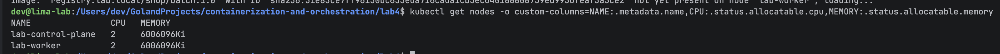

Заново поставил на этот кластер стек из лабы 2 (Prometheus, Grafana, Alertmanager, Karma — Loki/Jaeger тут не нужны), оператор CloudNativePG и Kyverno с политиками лабы 3 — гвардрейлы действуют без исключений.

`batch` — новый шаблон [`batch.yaml`](charts/shop/templates/batch.yaml), включается [`values/part2-batch.yaml`](values/part2-batch.yaml):

```bash
helm install shop charts/shop -n shop --set monitoring.enabled=true --wait
helm upgrade shop charts/shop -n shop --reuse-values -f values/part2-batch.yaml --wait
```

У `batch` всё по гвардрейлам: метки, `requests: 250m / 128Mi`, `limits: 500m / 256Mi`, образ из `registry.lab.local`, не privileged — Kyverno пропустил.

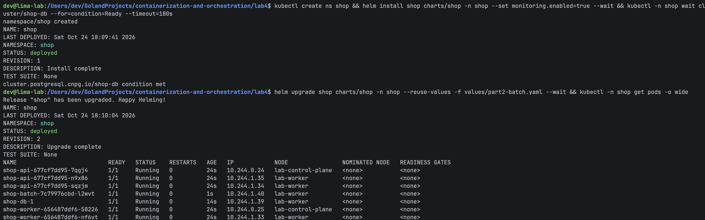

Без правил разнесения планировщик положил 2 из 3 подов `api` на `lab-worker`. Упадёт эта нода — пропадут сразу две трети `api`. Это «до» для части 4.

## Часть 3 — реальные числа вместо угадывания

Сначала нагрузка по пути заказа — k6, 5 минут по 20 заказов в секунду через NodePort ([`load/order.js`](load/order.js)):

```bash
k6 run -e BASE_URL=http://<IP ноды>:30080 -e RATE=20 -e DURATION=5m load/order.js
```

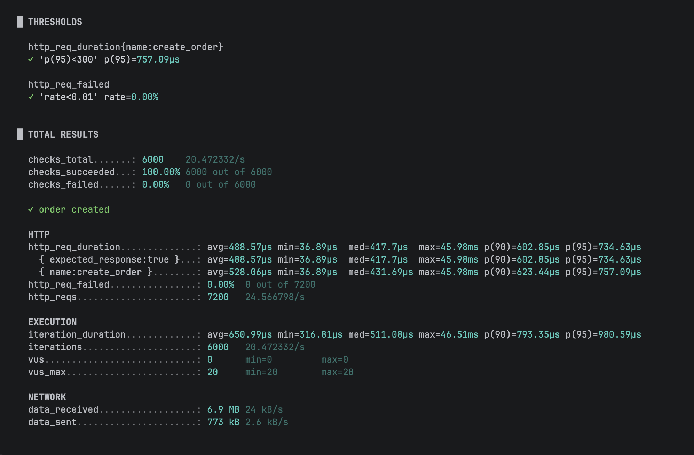

Это заодно базовая линия SLA **без** перегрузки: p95 оформления заказа 0.76 мс при пороге 300 мс, 6000 заказов, 0% ошибок.

Потом [krr](https://github.com/robusta-dev/krr) против namespace `shop` (готовая сборка krr под macOS оказалась сломана — ошибка PyInstaller, — поставил из исходников; запускал на маке, к кластеру и Prometheus — через проброшенные порты):

```bash
krr simple -k ~/.kube/kind-lab.yaml -p http://localhost:9090 -n shop --history_duration 1 --points_required 10
```

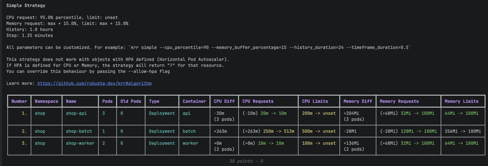

Полный отчёт — [`krr/report.yaml`](krr/report.yaml). Стратегия `simple`: CPU request = p95 потребления, CPU limit — не ставить; память request и limit = максимум + 15%.

### Догадка против krr против реальности

| | моя догадка (req / lim) | krr | реально (за 1 ч с нагрузкой) |
|---|---|---|---|
| api CPU | 20m / 200m | **10m** / нет лимита | p95 2m, max 2.5m |
| api память | 32Mi / 64Mi | **100Mi** / 100Mi | max 11 МиБ |
| worker CPU | 10m / 100m | 10m / нет лимита | p95 0.6m |
| worker память | 32Mi / 64Mi | 100Mi / 100Mi | max 11 МиБ |
| batch CPU | 250m / 500m | **513m** / нет лимита | упирается в limit 500m |
| batch память | 128Mi / 256Mi | 100Mi / 100Mi | max 67 МиБ |
| postgres CPU | 50m / 500m | krr не видит | p95 10m |
| postgres память | 128Mi / 256Mi | krr не видит | max 82 МиБ |

Почему расходится:

- **Память api/worker — 100Mi при реальных 11 МиБ.** Это не измерение, а **минимальные значения krr** (`memory_min_value: 100` МБ, `cpu_min_value: 10m` в его конфиге). Реальное потребление ниже — krr подтягивает до своего пола. CPU по той же причине 10m.
- **CPU и память считаются по-разному.** CPU — p95: упёрся в CPU — процесс просто притормаживают (throttling, лаба 1 часть 3). Память — максимум + 15%: упёрся в лимит памяти — OOMKill. Ошибка по памяти дороже, поэтому берут максимум с запасом.
- **batch — 513m.** batch жрёт столько CPU, сколько дадут, и упирается в свой limit — krr честно говорит «ему нужно больше». Специально не поднимаю: batch — фоновая жертва, его requests держим низкими (часть 5).
- **postgres krr не видит** — его поды принадлежат объекту `Cluster` оператора, а krr знает только Deployment/StatefulSet/DaemonSet/Job и т.п. Посчитал тем же методом напрямую из Prometheus: p95 CPU 10m, память max 82 МиБ → +15% → 95 МиБ → минимум 100Mi. **Но** `shared_buffers` у postgres = 128MB: по мере работы база заполнит буфер и упрётся в 100Mi — OOMKill. История в 1 час этого просто не видела, как не видела бы ночную аналитику или пиковый день месяца. Поэтому для postgres оставил 256Mi: krr — хорошая отправная точка, но не истина, её надо проверять пониманием того, как устроено приложение.

Применил через [`values/part3-krr.yaml`](values/part3-krr.yaml) (откуда каждое число — в комментариях; `null` убирает CPU limit, как советует krr):

```bash
helm upgrade shop charts/shop -n shop --reuse-values -f values/part3-krr.yaml --wait   # дальше — без --reuse-values, см. часть 4
```

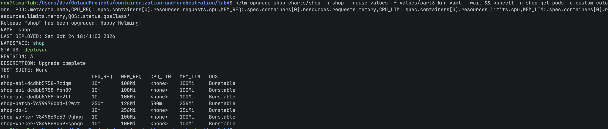

Пока у всех подов QoS `Burstable` — к этому вернусь в части 5.

## Часть 4 — разнесение api

Включил механизм из части 1 — [`values/part4-spread.yaml`](values/part4-spread.yaml): `topologySpread`, `maxSkew: 1`, жёсткий режим (`DoNotSchedule`).

Начиная с этой части применяю **все надстройки по порядку**, без `--reuse-values`:

```bash
helm upgrade shop charts/shop -n shop -f values/part0-install.yaml -f values/part2-batch.yaml \
  -f values/part3-krr.yaml -f values/part4-spread.yaml --wait
```

Грабли: с `--reuse-values` апгрейд упал (`requests: Invalid value: "10m": must be less than or equal to cpu limit of 0`). `cpu: null` в надстройке части 3 убирает CPU limit только когда надстройка накладывается на дефолты чарта; `--reuse-values` же берёт значения прошлого релиза, и `null` уходит в манифест буквально. С полным списком `-f` всё честно: вся конфигурация видна в одной команде и воспроизводится с нуля.

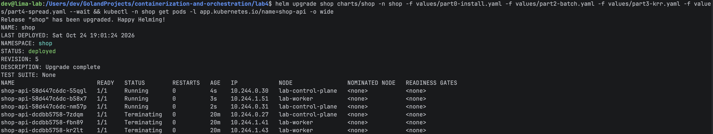

Шаблон пода изменился → rolling update, и новые поды встали уже по правилу: 2 на `lab-control-plane`, 1 на `lab-worker`.

**Как это повышает отказоустойчивость.** Падает любая нода (сбой, перезагрузка) — на другой остаётся хотя бы одна реплика `api`, Service сразу перестаёт слать трафик на потерянные, и сервис продолжает отвечать, пока Deployment не пересоздаст недостающие поды. Без разнесения все три реплики могли оказаться на одной ноде (в части 2 так и было: 2 из 3 на `lab-worker`), и её потеря остановила бы `api` целиком. Предел: на двух нодах потеря «двойной» ноды оставляет одну реплику из трёх — доступность есть, ёмкости меньше. Полнее защищают только больше нод или реплик.

## Часть 5 — приоритеты и гарантии

[`values/part5-priority.yaml`](values/part5-priority.yaml) + шаблоны [`priorityclass.yaml`](charts/shop/templates/priorityclass.yaml) и [`pdb.yaml`](charts/shop/templates/pdb.yaml).

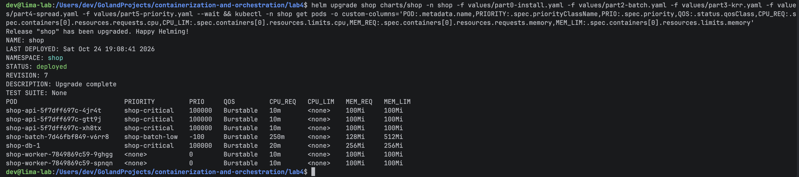

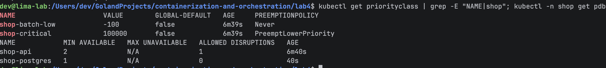

| | PriorityClass | CPU request / limit | Память request / limit | QoS | PDB |
|---|---|---|---|---|---|
| api | `shop-critical` (100000) | 10m / **нет** | 100Mi / 100Mi | Burstable | `minAvailable: 2` |
| postgres | `shop-critical` (100000) | 20m / **нет** | 256Mi / 256Mi | Burstable | `minAvailable: 1` |
| worker | обычный (0) | 10m / нет | 100Mi / 100Mi | Burstable | — |
| batch | `shop-batch-low` (−100, `preemptionPolicy: Never`) | 250m / нет | 128Mi / 512Mi | Burstable | — |

### Почему не Guaranteed: без CPU-лимитов

Задание просит для api/postgres QoS Guaranteed — а его Kubernetes даёт, только если `limits = requests` у каждого контейнера и по памяти, **и по CPU**. CPU-лимиты я сознательно не ставлю (совет преподавателя; krr тоже рекомендует `CPU limit: unset`):

- CPU-лимит — жёсткий потолок: под троттлится даже на свободной ноде (CFS-квота, лаба 1 часть 3). Взять лимит «по krr» = душить под на первом же пике. У другого студента на этой же лабе ровно так и вышло: postgres с CPU limit = рекомендация krr уходил в 100% троттлинг, и p95 заказа взлетал до секунд;
- без лимита CPU request работает как **вес** (`cpu.weight` в cgroup v2): свободный CPU может брать кто угодно, а при конкуренции ядро делит CPU пропорционально requests. Это и есть гарантия критического пути. Поэтому CPU request api/postgres снят под нагрузкой **выше обещанной**: 100 заказов/с (в 5 раз больше SLA-нагрузки) — p95 CPU api 9m на под → 10m, postgres 18m → 20m;
- лимиты памяти есть у всех — гвардрейлы лабы 3 требуют именно их, CPU-лимит Kyverno не требует.

Цена: QoS у api/postgres — Burstable. Под давлением по памяти это почти ничего не меняет (см. ниже), а то, что Guaranteed дал бы сверх этого, — минимальный `oom_score_adj` (−997) при **ядерном** OOM ноды.

### Что даёт каждая настройка под давлением

- **PriorityClass** — при **нехватке места при планировании**. Не влез под с высоким приоритетом — планировщик вытесняет (preempt) поды с более низким, чтобы освободить место. `shop-critical` может вытеснять `batch`; `batch` с `preemptionPolicy: Never` сам не вытесняет никого — не влез, значит ждёт в Pending. Приоритет −100 ниже всех обычных подов кластера (у них 0): `batch` жертвуем первым.
- **QoS / requests** — при **нехватке ресурсов на ноде**. Давление по памяти → kubelet выбирает, кого выселить (eviction), по порядку: сначала поды, у которых потребление **выше их memory requests**, среди них — с **меньшим приоритетом**, дальше — у кого превышение больше. `batch` держит память сильно выше своих 128Mi и с приоритетом −100 → первый. `api` (11 МиБ при request 100Mi) и postgres (85 МиБ при 256Mi) свой резерв не превышают → в самом конце очереди. Классы на этом и построены: BestEffort (requests нет вообще) всегда «превышает» — уходит первым; Burstable — если вылез за requests; Guaranteed по определению за requests не вылезает — уходит последним. Поэтому для порядка выселения важно не название класса, а «держится ли под в своих requests» — api держится и без Guaranteed.
- **PDB** — только **добровольные** выселения: `kubectl drain`, eviction API. `shop-api` `minAvailable: 2` — из трёх реплик за раз можно увести не больше одной (`ALLOWED DISRUPTIONS 1`). `shop-postgres` `minAvailable: 1` при одном экземпляре — `0`: базу добровольно не трогаем вообще. От падения ноды PDB не спасает — от этого защищает разнесение (часть 4).

Грабли: PDB для postgres я сначала назвал `shop-db` — и оператор CloudNativePG его тут же удалял, а Helm висел до таймаута (`PodDisruptionBudget/shop/shop-db not ready`). Оператор называет свой PDB по имени кластера и, раз мы выключили его PDB (`enablePDB: false`), удаляет любой объект с этим именем. Переименовал в `shop-postgres`.

## Части 6–9 — один эксперимент под нагрузкой

Всё время частей 6–7 k6 держал обычную нагрузку — 20 заказов/с, 30 минут. В это время я создавал нехватку (часть 6) и давление по памяти (часть 7), а потом смотрел по графикам, удержался ли SLA (часть 8) и что поймали алерты (часть 9).

## Часть 6 — нехватка, Pending и preemption

### Pending

Поднял `batch` до 12 реплик — [`values/part6-scarcity.yaml`](values/part6-scarcity.yaml). По расчёту свободного CPU (по requests) хватало примерно на 9 подов по 250m:

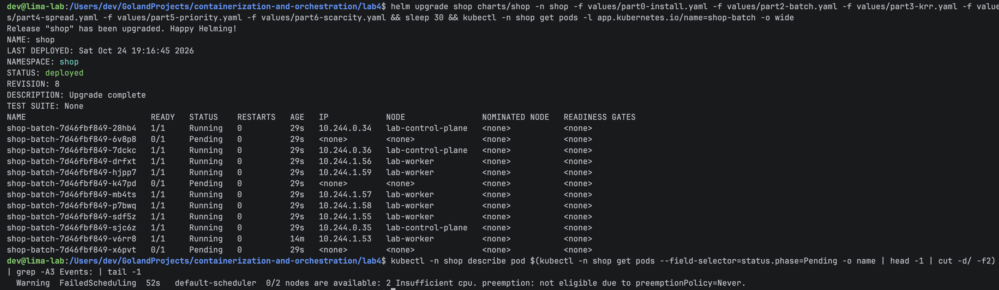

9 `Running`, 3 `Pending`: `0/2 nodes are available: 2 Insufficient cpu. preemption: not eligible due to preemptionPolicy=Never`. Сами `batch` никого не вытесняют — `preemptionPolicy: Never`, не влез — ждёт.

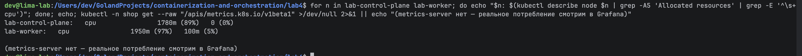

Заказано CPU 89% и 97% нод — а реально `batch` жжёт около трети ядра (`cpuDuty: 30`), на нодах полно свободного процессора. **Планировщик считает по requests, а не по факту**: requests — это обещание «столько тебе гарантировано», и он не ставит под, если не может это обещание выполнить. Реальная загрузка на это не влияет.

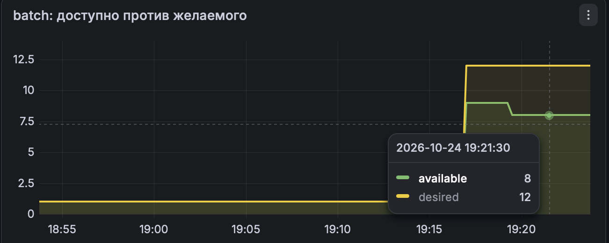

### Preemption

Пик: критическому `api` понадобилось резко вырасти до 24 реплик — [`values/part6-preempt.yaml`](values/part6-preempt.yaml). У `api` request всего 10m, поэтому реплик нужно много, чтобы им перестало хватать щелей.

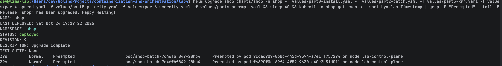

`Preempted by pod ... on node lab-control-plane`: новому `api` (приоритет 100000) не хватило места — планировщик выбрал на ноде под с самым низким приоритетом (`batch`, −100), удалил его и поставил `api` на освободившееся место.

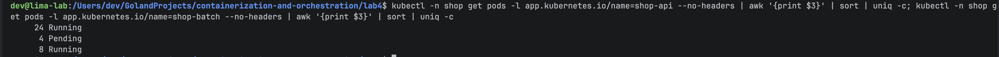

Все 24 `api` `Running`, `batch` было 9 из 12 — стало 8. Вытесненный `batch` не исчез: ReplicaSet пересоздал его, и он встал в очередь `Pending` к остальным.

### Побочный эффект: упал Kyverno

Пока на нодах жили 24 `api` и 8 `batch`, Kyverno перестал отвечать (`failed calling webhook "validate.kyverno.svc-fail" ... connection refused`), и следующий `helm upgrade` не прошёл. Причина — отказ от CPU-лимитов в части 5: при конкуренции за CPU ядро делит его по requests, а у каждого `batch` вес 250m против 100m у admission-контроллера Kyverno. Kyverno не успевал отвечать на liveness-пробу, kubelet его перезапустил, а пока он поднимался, вебхук с `failurePolicy: Fail` блокировал любые изменения (как в лабе 3, часть 4). Вывод: без CPU-лимитов от «шумного соседа» защищают только **реалистичные requests у всех**, включая инфраструктуру. Через минуту Kyverno поднялся, и всё прошло.

## Часть 7 — давление по памяти

В kind порог выселения по памяти **не задан вообще** — в конфиге kubelet были только пороги по диску. Задал на `lab-worker` `evictionHard: memory.available: 4Gi` (из-за `systemReserved` это примерно «поды на ноде съели больше ~1.7 ГБ») и `evictionPressureTransitionPeriod: 30s` (по умолчанию нода 5 минут остаётся в состоянии давления после того, как оно спало).

[`values/part7-memory.yaml`](values/part7-memory.yaml): `api` вернул к 3 репликам, `batch` прибил к `lab-worker` (там порог) и поднял его память — 4 пода по 500 МБ, это выше их requests (128Mi).

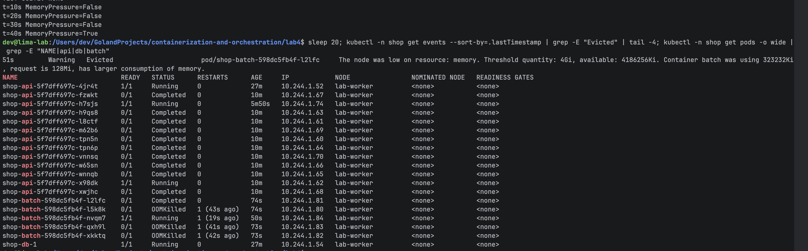

Через 40 секунд `MemoryPressure=True`, и kubelet выселил `batch`: `The node was low on resource: memory. Threshold quantity: 4Gi, available: 4186256Ki. Container batch was using 323232Ki, request is 128Mi, has larger consumption of memory.` — kubelet прямо пишет, почему именно этот под: потребляет больше своего request.

`api` и `shop-db-1` на той же ноде остались `Running`, рестартов 0. Выселен только `batch` — по событиям в namespace больше никого. (`Completed` у кучи подов `api` — это не выселение, а 21 лишняя реплика после возврата с 24 до 3.)

Ещё видно `OOMKilled` у нескольких `batch` — это я промахнулся с числом: 500 МБ `batch` набирает кусками по 16 МиБ, выходит 512 МиБ плюс рантайм Go — больше собственного лимита 512Mi. Получилось наглядно: на одном экране оба диагноза.

### Evicted против OOMKilled

Для чистоты — один `batch` с 700 МБ при лимите 512Mi ([`values/part7-oomkill.yaml`](values/part7-oomkill.yaml)), давления на ноду нет:

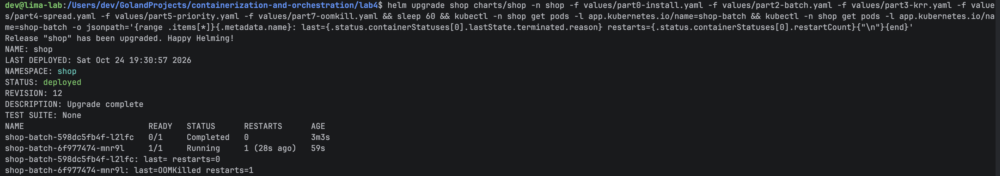

`last=OOMKilled`, `restarts=1` — и под тот же, на той же ноде.

| | Evicted | OOMKilled |
|---|---|---|
| кто убивает | **kubelet** | **ядро** (OOM killer в memory cgroup) |
| из-за чего | на **ноде** кончается память (ниже порога `evictionHard`) | **контейнер** упёрся в свой `limits.memory` |
| кого выбирают | по порядку: превысил ли requests → приоритет → насколько превысил | только тот контейнер, что упёрся в лимит |
| что с подом | под **удалён** с ноды, контроллер создаёт **новый** (может встать на другую ноду) | под **остаётся**, контейнер перезапускается на месте (`RESTARTS`++, при повторах — CrashLoopBackOff) |
| что чинить | ёмкость ноды / requests соседей / кто съел память ноды | лимит контейнера мал или в нём утечка |

Симптом одинаковый — «под умер, памяти не хватило», а диагнозы разные: в первом случае виновата нода и соседи, во втором — сам контейнер.

## Часть 8 — SLA под перегрузкой

**SLA:** 95% заказов оформляются быстрее **300 мс** и меньше 1% ошибок — даже когда кластер забит (`batch` в Pending, preemption) и на ноде давление по памяти. Порог прописан в k6 (`thresholds`) и в алерте `ShopOrderSLABreach`.

Итог k6 за все 30 минут эксперимента (20 заказов/с, параллельно с частями 6–7):

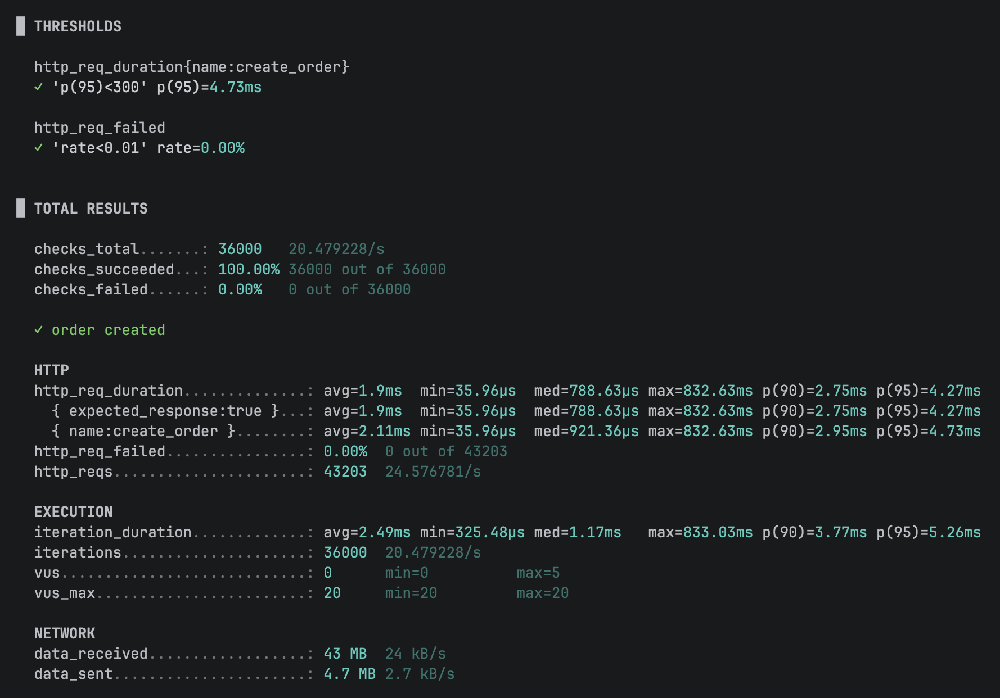

36 000 заказов, **p95 = 4.73 мс**, 0% ошибок — оба порога ✓. Для сравнения, без перегрузки (часть 3) p95 был 0.76 мс: задержка выросла в 6 раз, но до порога SLA ещё в 60 раз.

PS - мак никогда так не грелся)

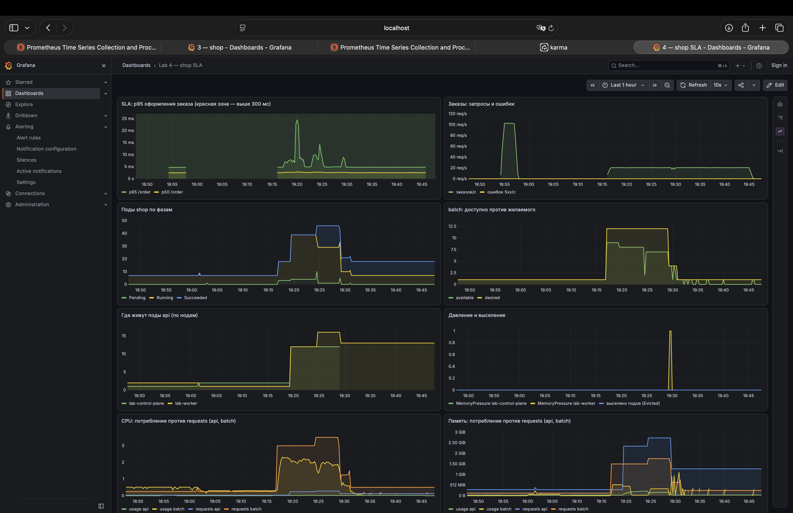

- **p95 /order** — всплески до ~25 мс в моменты preemption (19:20) и выселения (19:30), но далеко от красной зоны 300 мс; ошибок 5xx нет вовсе;
- **поды по фазам** — всплеск Pending и Succeeded: это `batch` в очереди и вытесненные/завершённые поды;
- **batch** — desired 12, available 9 → 8 (preemption), потом проседает до нуля при выселениях;
- **давление по памяти** — всплеск до 1 на `lab-worker` ровно в 19:30;
- **CPU** — `batch` заказал под 3 ядра и реально жёг ~2, а `api` при всём этом получал своё.

То есть деградирует именно `batch`: он ждёт в Pending, его вытесняют, выселяют. А путь заказа держит SLA.

(Скриншот дашборда снят до того, как я заменил панель «Давление и выселения» на «Давление по памяти на нодах» — см. часть 9.)

## Часть 9 — мониторинг

В чарте — [`monitoring.yaml`](charts/shop/templates/monitoring.yaml): `ServiceMonitor` (api, worker), `PodMonitor` (postgres), `PrometheusRule` и два дашборда (из лабы 3 и новый [«Lab 4 — shop SLA»](charts/shop/files/shop-sla-dashboard.json)) — всё поверх стека лабы 2.

### Три алерта лабы 4

| Алерт | Условие | Что ловит | Почему важно | Что делать |
|---|---|---|---|---|
| `ShopOrderSLABreach` | p95 `/order` > 300 мс 2 минуты | нарушение SLA пути заказа | это ровно то, что мы пообещали пользователю | дашборд SLA: хватает ли `api` CPU, Ready ли и разнесены реплики, нет ли давления по памяти на нодах |
| `ShopCriticalPodPending` | под `api`/`worker`/`postgres` в Pending > 1 мин (`batch` не считаю) | критическому пути не хватает места | приоритет должен был вытеснить `batch` — раз не вытеснил, места нет даже так: кластер мал или под не помещается на одну ноду | `kubectl describe pod` — причина в Events (`Insufficient cpu/memory`, taint, PVC на другой ноде) |
| `ShopNodeMemoryPressure` | на ноде `MemoryPressure=True` | kubelet выселяет (или вот-вот начнёт) поды | пока выселяют `batch` — так задумано; но это последний рубеж перед тем, как дойдёт до критических | `kubectl get events -A \| grep Evicted` — кого выселили; кто съел память ноды |

Pending у `batch` в `ShopCriticalPodPending` специально не считается: `batch` в Pending — нормальная работа приоритетов, а не авария.

Грабли: сначала третьим был алерт `ShopPodsEvicted` по `kube_pod_status_reason{reason="Evicted"}` — и в части 7 он **промолчал**. В Kubernetes 1.37 выселенный под, который корректно завершился по SIGTERM, остаётся `Succeeded` без `reason=Evicted`. Заменил на `ShopNodeMemoryPressure` — он ловит причину (давление на ноде), а не следствие.

### Что сработало

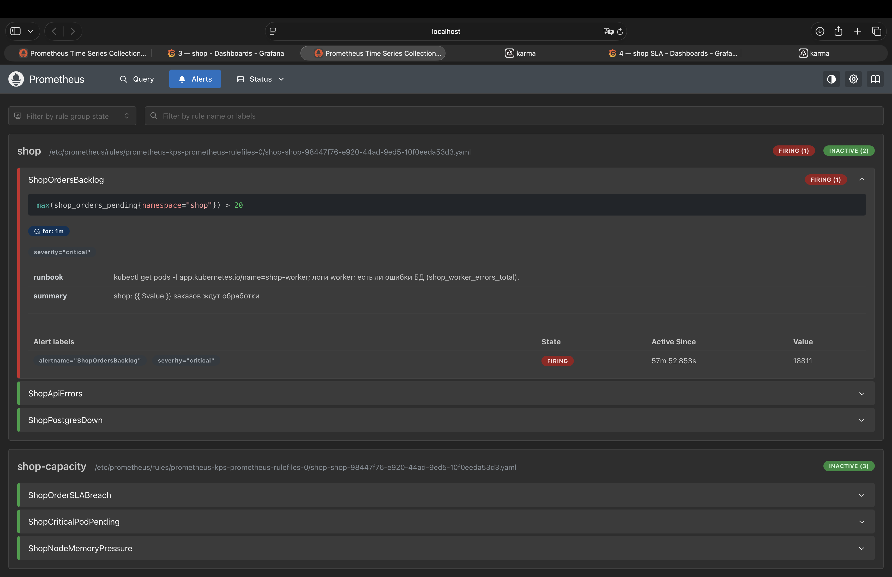

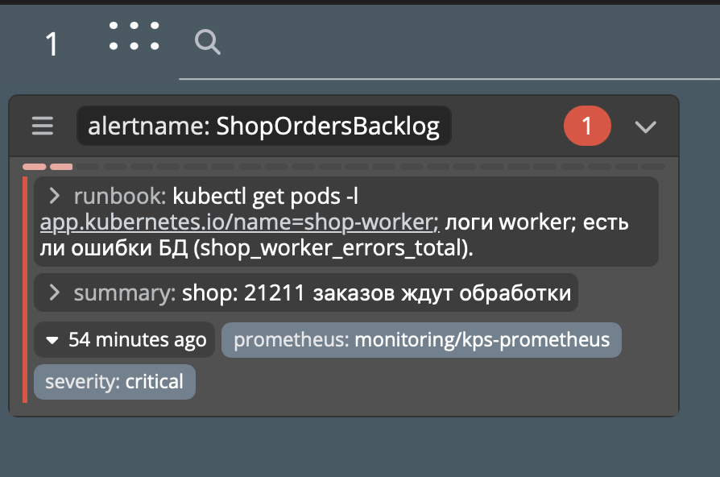

Весь эксперимент горел **`ShopOrdersBacklog`** (из лабы 3) — к концу в очереди 21 211 заказ. Это настоящая находка: worker обрабатывает по 10 заказов раз в 2 секунды на реплику, то есть 2 реплики дают 10 заказов/с, а k6 слал 20. Заказы **принимались** быстро (SLA пути заказа — про оформление, и он держится), но **обрабатывались** вдвое медленнее, чем приходили. По HTTP-метрикам этого не видно вообще — только по очереди. Лечится масштабированием worker (реплики или размер пачки) — именно то, что подсказывает runbook алерта.

Вывод про сам SLA: «95% заказов быстрее 300 мс» обещает только, что заказ быстро **принят** (HTTP 201), но не что его **обработают**. Поэтому одновременно «SLA выполнен» и «20 тысяч заказов висят в очереди». Честный SLA стоит дополнить вторым пунктом — например, «заказ обработан не позже чем через 1 минуту» — и мерить его по очереди или по возрасту самого старого необработанного заказа.

## Итог

- реплики `api` разнесены по нодам (`topologySpread`, 2 + 1) даже на 2-нодовом кластере;
- requests критического пути взяты из `krr` и замеров под нагрузкой, расхождение с догадкой объяснено;
- у всех подов, включая `batch`, есть лимиты памяти — гвардрейлы лабы 3 без исключений; CPU-лимитов нет ни у кого — осознанно (см. часть 5);
- `Pending` и preemption под нехваткой — увидены и объяснены: планировщик считает по requests, `batch` вытесняется по приоритету;
- eviction под давлением по памяти забрал `batch`, `api` и `postgres` на той же ноде остались — потому что `batch` вылез за свои requests и у него самый низкий приоритет; отличие от `OOMKilled` показано;
- SLA «95% заказов быстрее 300 мс» держится под перегрузкой: p95 4.73 мс, 0% ошибок;
- дашборд и 3 алерта поверх стека лабы 2, встроенные в чарт; алерт на очередь поймал реальную проблему с пропускной способностью worker.
